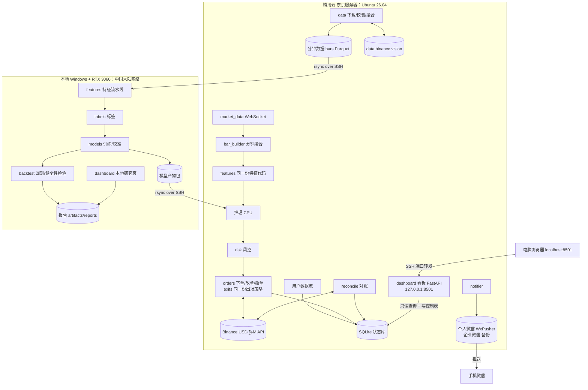

# 02 系统架构与部署

## 1. 总体架构

系统分为**东京服务器**（数据下载、实盘交易、看板）与**本地 Windows**（训练、回测研究）两端，共享同一个 Python 包 `trade`。两端之间只通过 SSH 传输三类东西：代码（git over SSH）、分钟数据（rsync）、模型产物（rsync）。**本地从不直接访问币安。**



看板与交易进程是**两个独立进程**：看板崩溃或重启不影响交易；看板对交易的控制（调仓位、停机）只通过写状态库的控制表实现，与命令行脚本走同一条路径（10 §8）。

## 2. 模块职责

| 包路径            | 职责                                                                                                                    | 运行位置                       |
| :---------------- | :---------------------------------------------------------------------------------------------------------------------- | :----------------------------- |
| `trade.common`    | 配置加载与校验、日志、路径、时间工具、随机种子、仓位计算 `sizing`、**出场策略 `exits`**、交易规则取整（回测与实盘共用） | **双端共用**                   |
| `trade.data`      | 交易规则拉取、**规则化月度选币 `universe`（离线与实盘共用）**、历史数据下载与校验、原始数据→分钟数据聚合、数据质量报告  | 下载与聚合在服务器；加载在双端 |
| `trade.features`  | 特征计算（K 线类、订单流类、市场环境类、合约类）、归一化、特征注册表                                                    | **双端共用**                   |
| `trade.labels`    | 预过滤、三重障碍标签                                                                                                    | 本地                           |
| `trade.models`    | 数据集、规则策略 R0、TCN/LSTM/LightGBM、训练、校准、阈值、导出、加载                                                    | 本地训练，双端加载             |
| `trade.backtest`  | 批量推理、成交模拟、成本模型、组合约束、指标、健全性检验、事件驱动参考模拟器、报告                                      | 本地                           |
| `trade.live`      | 币安客户端、行情、分钟聚合、月度再平衡（调用 `trade.data.universe`）、交易引擎、风控、订单、对账、状态库、通知          | 服务器                         |
| `trade.dashboard` | 网页看板（FastAPI + 静态前端，深色 iOS 风格，10），研究页面与实盘页面；只读状态库，不调用币安 API                       | 双端（实盘页在服务器）         |

## 3. 核心设计原则

1. **特征只有一份实现。** `trade.features` 的函数既被离线流水线批量调用，也被实盘按分钟增量调用。特征函数输入统一为“截至 t 时刻的分钟数据 DataFrame（末尾若干行）”，输出 t 时刻特征向量；离线批量计算对整列向量化，但必须通过 08 §2 P2 的“一致性测试”（同一段数据，批量结果与逐分钟增量结果误差 < 1e-6）。
2. **出场策略只有一份实现。** `trade.common.exits` 是一个纯数值状态机（输入：入场信息 + 每根已收盘 K 线；输出：当前止损价、封顶止盈价、是否离场），回测预计算、事件驱动参考模拟器与实盘订单管理调用同一份代码（06 §3.3、07 §5.2）。
3. **时间语义统一。** 所有时间戳使用 UTC、整数毫秒（`int64`）。K 线以 `open_time` 为主键。“t 时刻的信息”= 第 t 根 K 线收盘（`open_time + 60000 - 1` 毫秒）时已知的一切。看板与通知显示北京时间（UTC+8），存储与计算一律 UTC。
4. **配置驱动。** 所有阈值、费率、窗口长度均来自 YAML 配置，代码中禁止硬编码魔法数字（常量定义除外）。
5. **可复现。** 固定随机种子；每次训练/回测输出 `run_id` 目录，内含完整配置快照、Git 提交号、数据文件哈希、依赖版本。
6. **失败即停。** 数据缺失、配置非法、特征哈希不匹配时直接抛错退出，不做静默降级。实盘例外：遇到异常进入“只平不开”安全模式（07）。
7. **控制单通道。** 运行中改变交易行为的唯一途径是状态库的 `runtime_overrides` 表与 `risk_state.halt_flag`。命令行脚本与看板都调用 `trade.live.control` 中的同一组函数写入，交易进程每分钟读取。
8. **网络单向。** 本地机器只连接服务器（SSH）与国内镜像；凡需访问币安或海外站点的步骤，一律设计为在服务器上执行。
9. **阶段解耦。** 各阶段之间只通过文件契约衔接（08 §6），任一阶段可单独运行、单独测试。

## 4. 技术栈

| 类别          | 选型                                                                                                  | 说明                                                                                           |
| :------------ | :---------------------------------------------------------------------------------------------------- | :--------------------------------------------------------------------------------------------- |
| 语言          | Python 3.11~3.13（本地 3.13 为主；服务器用发行版 Python，Ubuntu 26.04 需用 uv 装 3.13）               | 双端一致                                                                                       |
| 深度学习      | PyTorch 2.x（本地 CUDA 12.x；服务器 CPU 版）                                                          |                                                                                                |
| 数据处理      | pandas 2.x、numpy、pyarrow                                                                            | Parquet 读写                                                                                   |
| 加速          | numba                                                                                                 | 回测顺序模拟、三重障碍标签、出场策略预计算                                                     |
| 基线模型      | lightgbm                                                                                              | 仅本地                                                                                         |
| 配置          | pydantic v2 + PyYAML                                                                                  | 配置模型强校验                                                                                 |
| 币安签名 REST | 官方 SDK `binance-sdk-derivatives-trading-usds-futures`（锁定 18.2.0），封装在 `ExchangeClient` 协议之后 | 官方维护、跟进接口变更（如条件单迁移到 Algo 接口）；若延迟或异步能力不满足，再在协议后自研替换 |
| 行情 WS       | websockets（自研轻量订阅）                                                                            | 便于控制重连、延迟测量、逐笔连续性检查                                                         |
| 状态存储      | SQLite（标准库 sqlite3，WAL 模式）                                                                    | 订单、持仓、成交、风控状态、控制表                                                             |
| 看板后端      | FastAPI + uvicorn                                                                                     | 只监听 127.0.0.1；JSON 接口 + WebSocket 推送（10 §3、§7）                                      |
| 看板前端      | 静态 HTML + 手写 CSS + Alpine.js、lightweight-charts、Plotly.js                                       | 不用 Node 构建；第三方 JS 下载到 `static/vendor/` 并锁定版本与 SHA256，不走 CDN                |
| 看板访问      | SSH 端口转发                                                                                          | 不使用域名、HTTPS 证书与反向代理（§5.6）                                                       |
| 通知          | WxPusher HTTP API（个人微信，主）+ 企业微信群机器人 Webhook（备份），httpx 直接调用                   | 见 07 §8                                                                                       |
| 报告绘图      | matplotlib                                                                                            | 回测报告静态图片                                                                               |
| 测试          | pytest                                                                                                |                                                                                                |
| 代码质量      | ruff（lint + format）、mypy                                                                           |                                                                                                |
| 依赖管理      | `pyproject.toml`（base/research/live/dev）+ `pip-tools --generate-hashes` 生成 `requirements-{base,research,live}.lock` | 版本与哈希全部锁定                                                                             |

不使用 ccxt 等通用交易所库：它们对币安合约算法条件单、用户数据流、权重头的支持更新滞后。币安接口清单见 09。

## 5. 部署与网络（中国大陆网络优先）

### 5.1 结论：腾讯云 东京地域

**服务器选用腾讯云的东京地域**（使用者确认，替代原 AWS 东京 / 阿里云方案）。

- 交易程序运行在东京服务器上，它访问币安走的是服务器自己的日本网络，与使用者本地是否开 VPN 无关。币安撮合普遍认为位于 AWS 东京区域；腾讯云东京与 AWS 东京同城，跨云网络往返通常为个位数毫秒，本策略的延迟预算是数百毫秒（07 §4），影响可以忽略。
- 选腾讯云的好处：中文控制台、支付宝付款、不需要外币信用卡；从中国大陆访问腾讯云海外地域（SSH、看板）的线路通常比访问 AWS 更稳定（以实测为准）。
- 使用者本地只需要能 SSH 到这台服务器。晚高峰仍可能偶有卡顿：用 `tmux` 保持会话，断线不影响服务器上的进程；交易进程由 systemd 守护，与 SSH 连接无关。
- 开通后在服务器上运行 `scripts/latency_probe.py`：不应出现 HTTP 451/403（地区限制或云厂商 IP 段被拒），且 REST P95 < 50 ms、WS 事件延迟 P95 < 200 ms。不满足则更换实例（换 IP）重测，仍不满足则退回 AWS 东京（附录方案：EC2 `t3.medium`，其余要求与 §5.5 相同）。
- **云厂商侧风险（须知）**：腾讯云中国站账号为国内实名，受国内监管与其服务协议约束；若服务器被认定用于虚拟货币相关业务，存在实例被停用的可能（具体条款以腾讯云服务协议与可接受使用政策为准）。应对：止损单始终挂在交易所，服务器突然停机时仓位仍受保护（07 §7.4）；手机上保留币安 App 作为最终的手动平仓手段；部署脚本与配置全部在 Git 中，可在数小时内迁移到其他云。
- 合规风险在账户层面，与服务器位置和云厂商无关（01 §7）。

### 5.2 网络链路清单

| 链路                          | 从 → 到                      | 大陆不开 VPN 是否可用  | 方案                                                                                                                  |
| :---------------------------- | :--------------------------- | :--------------------- | :-------------------------------------------------------------------------------------------------------------------- |
| 币安 REST / WS / 用户数据流   | 服务器 → 币安                | 不涉及（服务器在日本） | 直连                                                                                                                  |
| 历史数据 data.binance.vision  | 服务器 → 币安数据仓库        | 不涉及                 | 服务器下载并聚合，本地不下载                                                                                          |
| 代码同步                      | 本地 → 服务器                | 可用                   | 服务器上建裸仓库 `~/repos/trade.git`，本地 `git remote add tokyo ssh://...`，`git push tokyo`；不依赖 GitHub          |
| GitHub（可选备份 / 参考项目） | 服务器 → GitHub              | 不涉及                 | 需要拉开源项目源码时在服务器上 `git clone`，再按需同步；本地不直接访问                                                |
| 分钟数据、模型产物            | 服务器 ↔ 本地                | 可用                   | `rsync -avz --partial`（Windows 下通过 WSL 或 Git Bash 自带 rsync；无 rsync 时用 `scp`）。24 个月数据约 4~6 GB        |
| Python 依赖（本地）           | 本地 → PyPI                  | 慢 / 不稳定            | 使用清华或阿里云 PyPI 镜像，安装 `requirements-research.lock`（含 `torch==2.14.1+cu126`，CUDA 12.6，来自 PyTorch cu126 索引） |
| Python 依赖（服务器）         | 服务器 → PyPI                | 不涉及                 | 官方源，安装 `requirements-live.lock`（`torch==2.14.1`，Linux 下为 CPU 版）                                              |
| 通知                          | 服务器 → WxPusher / 企业微信 | 不涉及（国内服务）     | 个人微信（WxPusher 公众号）为主、企业微信群机器人为备份（07 §8）                                                      |
| 看板                          | 电脑 → 服务器 SSH            | 可用                   | SSH 端口转发 `ssh -N -L 8501:127.0.0.1:8501 tokyo`，浏览器打开 `localhost:8501`（§5.6）                               |
| 手机                          | 服务器 → 微信                | 不涉及（国内服务）     | 只接收微信推送（07 §8），不提供手机看板                                                                               |
| 紧急停机（手机）              | 手机 → 服务器 SSH            | 一般可用               | 手机安装 SSH 客户端（如 Termius），执行 `kill_switch.py`；最终手段为币安 App 手动平仓（10 §9.1）                      |
| 腾讯云控制台                  | 本地 → cloud.tencent.com     | 可用（国内服务）       | 开通、升降配、安全组                                                                                                  |

### 5.3 为什么不做“本地 → 币安”的代理

本设计**不包含**任何把中国大陆本地的币安请求通过代理、隧道转发出去的功能：

1. **合规**：币安用户协议限制受限地区用户通过技术手段规避地区限制，账户可能因此被冻结（01 §7）。
2. **技术上没有收益**：反正需要一台境外服务器，让交易程序直接跑在服务器上，比“本地程序 → 跨境代理 → 币安”少一跳跨境线路，延迟更低、故障点更少，止损单不会因为跨境线路抖动挂不上。
3. **安全**：签名请求与 API Key 不经过任何中间节点；API Key 的 IP 白名单直接绑定服务器固定公网 IP。

注意区分：§5.6 的 SSH 端口转发只把服务器上使用者自己的看板页面（127.0.0.1:8501）映射到本地浏览器，**不转发任何币安流量**，不属于上述范围。

### 5.4 端点选择（以官方文档为准，详见 09 §2）

| 用途             | 合约 USDⓈ-M                                                            |
| :--------------- | :--------------------------------------------------------------------- |
| REST 行情与交易  | `https://fapi.binance.com`                                             |
| WebSocket 行情   | `wss://fstream.binance.com`                                            |
| 测试网 REST / WS | `https://testnet.binancefuture.com` / 测试网对应 WS 地址（见官方文档） |
| 历史数据         | `https://data.binance.vision`                                          |

`scripts/latency_probe.py`：REST 请求 `/fapi/v1/time` 20 次 + WS 订阅 `btcusdt@bookTicker` 60 秒（统计事件时间与本机接收时间差），输出 P50/P95，并检查 HTTP 状态码（451/403 直接判定不可用）。实测（2026-10-31，东京服务器）REST P95 ≈ 11 ms、WS P95 ≈ 22 ms（bookTicker，60 秒）；`btcusdt@aggTrade`/`@kline_1m`/`@markPrice` 连接后无数据推送，其正确订阅方式留待 P5 `api_smoke.py` 以最新文档核实（09 §3.3）。

### 5.5 服务器要求

- 位置：腾讯云 **东京** 地域。注意购买时地域选“东京”，不要选国内地域（国内地域访问不了币安，且对外提供网页需要 ICP 备案）。价格以腾讯云官网为准。两种可选形态：
  - **云服务器 CVM**（推荐）：2 核 / 4 GB 的非突发性能实例（选标准型 S 这类，避免“突发性能实例”在数据聚合时 CPU 积分耗尽）；云硬盘 **60 GB**；分配固定公网 IP。首次批量聚合不需要升配：按 03 §2.1~§2.2 的单遍处理与分阶段调度，2 核下瓶颈是带宽而不是 CPU。
  - **轻量应用服务器**：2 核 4 GB 套餐，价格固定、含流量包、自带固定公网 IP；注意轻量服务器只能升配不能降配。使用者当前配置：30 Mbps 带宽、每月 1.5 TB 流量包；首次全量下载约 1~2 天（03 §3），以 P1 基准测试为准。
- 系统：Ubuntu 26.04 LTS（腾讯云公共镜像）。Ubuntu 26.04 自带 Python 3.14（超出项目 `>=3.11,<3.14`），服务器需用 `uv` 用户级安装 Python 3.13（见 §5.2、README）。
- 时钟：Ubuntu 默认 systemd-timesyncd 同步时间，程序启动时校验本机与币安服务器时差 < 500 ms，否则拒绝启动。
- 流量：入方向免费；出方向（同步数据到本地、看板经 SSH 隧道访问）按流量或带宽计费，本项目每月仅数 GB，费用很低。
- 进程守护：两个 systemd 服务：`trade-live.service`（交易进程，`Restart=on-failure`）、`trade-dashboard.service`（看板，`Restart=on-failure`）。日志按天滚动，保留 30 天。
- 安全组：入站**只开放 22**（SSH，仅密钥登录、禁用密码与 root 登录）；不开放 80、443。安装 `fail2ban` 保护 SSH。
- SSH 防掉线：客户端 `~/.ssh/config` 的 `Host tokyo` 加 `ServerAliveInterval 30`、`ServerAliveCountMax 3`；服务器 `/etc/ssh/sshd_config` 启用 `TCPKeepAlive yes`、`ClientAliveInterval 60`、`ClientAliveCountMax 3`（改后 `sudo sshd -t && sudo systemctl reload ssh`）。长任务（下载/聚合）用 `tmux` 运行，SSH 断开也不中断，重连后 `tmux attach` 恢复。
- 磁盘：逐笔原始 zip 下载一天、聚合一天、删除一天（03 §2.2），不长期保留，80 GB 足够。

### 5.6 看板访问（SSH 端口转发）

```text
电脑浏览器 http://localhost:8501 ──SSH 隧道（22）──▶ 服务器 127.0.0.1:8501 看板
手机 ◀── 微信推送（WxPusher 主、企业微信备份，07 §8）
```

- 看板只监听 `127.0.0.1`，**不对公网开放**；不购买域名，不使用 HTTPS 证书与反向代理。
- 电脑：`ssh -N -L 8501:127.0.0.1:8501 tokyo`（或 `scripts/sync.ps1 tunnel`），然后浏览器打开 `http://localhost:8501`。SSH 断线后重连隧道即可，看板与交易进程不受影响。
- 安全边界：能打开看板的前提是持有服务器 SSH 私钥；看板内控制操作仍需 PIN 二次确认、失败锁定，并校验请求的 `Host`/`Origin`（10 §8、§9）。
- 手机：只接收微信推送，不提供手机网页。紧急停机用手机 SSH 客户端执行 `kill_switch.py`，最终手段为币安 App 手动平仓（10 §9.1）。
- 不采用 Tailscale / WireGuard 等组网方案：它们在大陆网络下连通性不稳定，与“不依赖 VPN”的目标冲突。

### 5.7 本地开发环境

- Windows 10/11，RTX 3060，CUDA 12.x 对应的 PyTorch 安装包（通过国内镜像安装，§5.2）。
- 可选 WSL2 Ubuntu 训练：与服务器环境一致，自带 rsync，CUDA 在 WSL2 中可用。Windows 原生同样支持。
- 所有路径使用 `pathlib.Path`；文件名不含冒号等 Windows 非法字符（时间戳统一用 `YYYYMMDD`）；中文交易对名（如 `龙虾USDT`）在文件路径中使用币种序号别名（03 §1.1 第 7 条）。
- 本地看板：`python -m trade.dashboard --config configs/dashboard.yaml`（监听 127.0.0.1:8501），只浏览研究页面。

### 5.8 日常同步流程

```text
# 1) 本地改代码后推到服务器
git push tokyo main

# 2) 服务器下载与聚合（在服务器 tmux 中）
python scripts/download.py --config configs/base.yaml
python scripts/aggregate.py --config configs/base.yaml

# 3) 本地拉回分钟数据（WSL / Git Bash）
rsync -avz --partial <user>@<server>:~/trade/data/bars/ ./data/bars/
rsync -avz --partial <user>@<server>:~/trade/data/universe/ ./data/universe/   # 月度交易范围快照与 aliases.json

# 4) 本地训练、回测后，推送模型产物
rsync -avz ./artifacts/models/<model_id>/ <user>@<server>:~/trade/artifacts/models/<model_id>/
```

封装为 `scripts/sync.ps1`（Windows）与 `scripts/sync.sh`（WSL），服务器地址从 `~/.ssh/config` 的 `Host tokyo` 读取，脚本中不写 IP 与密钥。

### 5.9 终端复用（tmux）与断线保护

服务器上的长任务（下载、聚合、训练、手动联调实盘进程）用 `tmux` 运行，让进程与 SSH 会话解耦：SSH 断开后进程在服务器后台继续运行，重连后接回原会话即可查看结果，命令不会被中断。

- 新建会话：`tmux new -s trade`
- 分离（会话转入后台继续跑）：在会话内按 `Ctrl-b` 后按 `d`
- 列出会话：`tmux ls`
- 重新附着：`tmux attach -t trade`
- 结束会话（连同其中进程）：`tmux kill-session -t trade`

习惯用法：登录后先 `tmux attach -t trade || tmux new -s trade`，把长任务都放进这个会话；要退出时用 `Ctrl-b d` 分离，而不是直接关窗口，这样 SSH 断线只丢当前终端画面、不中断会话里的命令。多个任务用不同名称的会话（如 `download`、`live`）互不干扰。


## 6. 目录结构

```text
trade/
├─ pyproject.toml
├─ requirements-base.lock           # 共享核心依赖（哈希锁定）
├─ requirements-research.lock       # 本地研究（lightgbm/matplotlib/plotly + CUDA torch）
├─ requirements-live.lock           # 服务器实盘/看板（fastapi/uvicorn/币安 SDK + CPU torch）
├─ README.md                        # 环境安装（含国内镜像）与命令速查
├─ AGENTS.md                        # 工程规范
├─ configs/
│  ├─ base.yaml                     # 公共配置：时间窗口、路径、费率
│  ├─ universe.yaml                 # 规则化月度选币参数、留出组哈希规则（03 §4.6）
│  ├─ features.yaml                 # 特征开关与窗口
│  ├─ train.yaml                    # 模型与训练超参
│  ├─ exits.yaml                    # 出场策略参数（06 §3.3）
│  ├─ backtest.yaml                 # 成交/成本/组合参数、压力情景
│  ├─ sizing.yaml                   # 仓位与资金类风控（06 §5.4）
│  ├─ live.yaml                     # 实盘参数、风控阈值、通知
│  └─ dashboard.yaml                # 看板参数（10 §11）
├─ deploy/
│  └─ systemd/ trade-live.service  trade-dashboard.service
├─ src/trade/
│  ├─ common/   config.py logging.py paths.py timeutil.py seed.py sizing.py exits.py filters.py
│  ├─ data/     exchange_info.py universe.py downloader.py checksum.py
│  │            aggregate.py loader.py quality.py snapshot.py
│  ├─ features/ registry.py kline.py flow.py context.py futures.py
│  │            normalize.py pipeline.py
│  ├─ labels/   prefilter.py triple_barrier.py
│  ├─ models/   dataset.py rule_r0.py tcn.py lstm.py lgbm_baseline.py train.py
│  │            calibrate.py threshold.py artifact.py
│  ├─ backtest/ signals.py costs.py simulator.py portfolio.py event_sim.py metrics.py
│  │            sanity.py report.py
│  ├─ live/     exchange/{client.py, ws.py, endpoints.py, models.py}
│  │            market_data.py bar_builder.py engine.py risk.py orders.py
│  │            reconcile.py store.py control.py health.py
│  │            notifier/{base.py, wecom.py, feishu.py, wxpusher.py}
│  └─ dashboard/ __main__.py  app.py（FastAPI）  api.py  ws.py  queries.py  security.py
│                 static/{index.html, css/, js/, vendor/（锁定版本，VERSIONS.txt）}（10）
├─ scripts/
│  ├─ check_env.py   latency_probe.py   select_coins.py   download.py   aggregate.py
│  ├─ snapshot_rules.py             # exchangeInfo/leverageBracket 快照 + rules.json（服务器）
│  ├─ build_dataset.py   train.py   backtest.py   run_live.py   kill_switch.py   set_sizing.py
│  ├─ api_smoke.py                  # 币安接口冒烟测试（09 §8）
│  └─ sync.ps1   sync.sh            # 本地 ↔ 服务器同步（§5.8）
├─ tests/                           # 与 src 结构对应
├─ data/                            # .gitignore
│  ├─ raw/        aggTrades 等原始 zip（服务器，处理后删除）
│  ├─ universe/   {YYYY-MM}.json、aliases.json           # 月度交易范围快照（03 §4）
│  ├─ bars/       {symbol_alias}/{YYYYMM}.parquet       # 分钟级聚合
│  ├─ features/   {run_id}/{symbol_alias}.parquet
│  └─ labels/     {run_id}/{symbol_alias}.parquet
└─ artifacts/                       # .gitignore
   ├─ models/     {model_id}/model.pt model_meta.json train_log.csv
   ├─ reports/    {run_id}/report.md *.png trades.parquet   EXPERIMENTS.log  FINAL_RUNS.log
   └─ live/       state.db logs/ bars/ daily/
```

## 7. 配置规范

- 加载顺序：`base.yaml` ← 专用配置（如 `train.yaml`）← 命令行 `--set key=value` 覆盖。实盘另有 `runtime_overrides`（状态库）优先级最高，仅限 07 §7.1.1 列出的仓位类参数。
- 每个配置文件对应一个 pydantic 模型，未知字段报错（`extra="forbid"`）。
- 敏感信息**不得**写入 YAML，从环境变量读取；服务器上放在 `/etc/trade/env`（权限 600），由 systemd `EnvironmentFile` 注入；本地开发放在 `trade/.env`（已加入 `.gitignore`），本地不存放实盘密钥。

| 环境变量                                                 | 用途                                                  |
| :------------------------------------------------------- | :---------------------------------------------------- |
| `BINANCE_API_KEY`                                        | 币安 API Key                                          |
| `BINANCE_API_SECRET` / `BINANCE_PRIVATE_KEY_PATH`        | HMAC Secret，或 Ed25519 私钥文件路径（二选一，09 §5） |
| `BINANCE_TESTNET_API_KEY` / `BINANCE_TESTNET_API_SECRET` | 测试网密钥（`paper` 模式）                            |
| `WXPUSHER_APP_TOKEN` / `WXPUSHER_UID`                    | 个人微信主通道（07 §8.2）                             |
| `WECOM_WEBHOOK_KEY`                                      | 企业微信群机器人 key（备份通道：告警、停机、心跳）    |
| `FEISHU_WEBHOOK_URL` / `FEISHU_SECRET`                   | 可选：飞书机器人                                      |
| `DASHBOARD_CONTROL_PIN`                                  | 看板控制操作二次确认 PIN（10 §8）                     |

`base.yaml` 示例：

```yaml
market: usdm # 固定为 usdm
quote_asset: USDT
data_window:
  end_month: "2026-09" # 最后一个完整自然月（含）
  months: 24
  warmup_days: 30 # 特征预热（EWM 半衰期 3 天的 10 倍，残余权重约 0.1%）
  tuning_months: 12 # 调参期 M1~M12（03 §6）
  holdout_months: 2 # 封存月数量（取窗口末尾）
fees: # VIP0、不使用 BNB 抵扣；实盘启动时以 /fapi/v1/commissionRate 实际值校验（09 §4）
  maker: 0.0002
  taker: 0.0005
display_tz: Asia/Shanghai # 仅用于看板与通知显示
paths:
  data_root: ./data
  artifact_root: ./artifacts
seed: 42
```

## 8. 日志规范

- 使用标准库 `logging`，JSON 格式一行一条，字段至少包含 `ts`、`level`、`module`、`event`、`symbol`（如有）、`run_id`/`session_id`。
- 实盘关键事件（信号、下单请求、交易所响应、成交、改单、撤单、风控拒绝、对账差异、控制操作）级别为 INFO 及以上，必须落盘。
- 日志中禁止输出 API Secret、私钥、签名、Webhook key / 完整 Webhook URL、看板 PIN。
