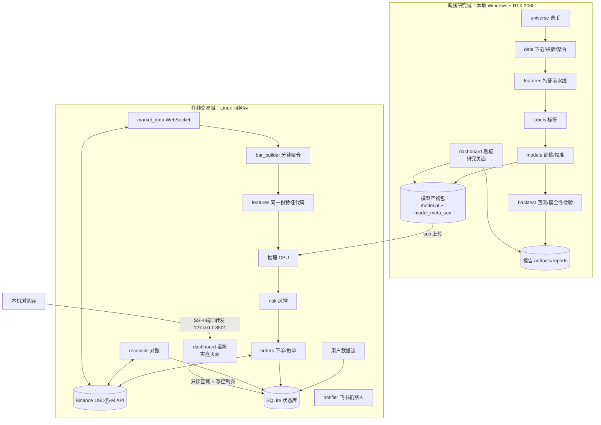

# 02 系统架构与部署

## 1. 总体架构

系统分为离线研究域（本地 Windows）、在线交易域（实盘 Linux 服务器）和看板（两端都可运行），共享同一个 Python 包 `trade`，通过“模型产物包”和“SQLite 状态库”衔接。



看板与交易进程是**两个独立进程**：看板崩溃或重启不影响交易；看板对交易的控制（调仓位、停机）只通过写状态库的控制表实现，与命令行脚本走同一条路径（见 10 §4）。

## 2. 模块职责

| 包路径            | 职责                                                                                              | 运行域                 |
| :---------------- | :------------------------------------------------------------------------------------------------ | :--------------------- |
| `trade.common`    | 配置加载与校验、日志、路径、时间工具、随机种子、仓位计算 `sizing`（回测与实盘共用）、交易规则取整 | **双端共用**           |
| `trade.data`      | 交易规则拉取、选币、历史数据下载与校验、原始数据→分钟数据聚合、数据质量报告                       | 本地（下载可在服务器） |
| `trade.features`  | 特征计算（K 线类、订单流类、市场环境类、合约类）、归一化、特征注册表                              | **双端共用**           |
| `trade.labels`    | 预过滤、三重障碍标签                                                                              | 本地                   |
| `trade.models`    | 数据集、TCN/LSTM/LightGBM、训练、校准、阈值、导出、加载                                           | 本地训练，双端加载     |
| `trade.backtest`  | 批量推理、成交模拟、成本模型、组合约束、指标、健全性检验、报告                                    | 本地                   |
| `trade.live`      | 币安客户端、行情、分钟聚合、交易引擎、风控、订单、对账、状态库、飞书通知                          | 实盘服务器             |
| `trade.dashboard` | localhost 网页看板（Streamlit），研究页面与实盘页面                                               | 双端                   |

## 3. 核心设计原则

1. **特征只有一份实现。** `trade.features` 的函数既被离线流水线批量调用，也被实盘按分钟增量调用。实现方式：特征函数的输入统一为“截至 t 时刻的分钟数据 DataFrame（末尾若干行）”，输出 t 时刻特征向量；离线批量计算时对整列向量化，但必须通过 08 §2 P2 的“一致性测试”（同一段数据，批量结果与逐分钟增量结果误差 < 1e-6）。
2. **时间语义统一。** 所有时间戳使用 UTC、整数毫秒（`int64`）。K 线以 `open_time` 为主键。“t 时刻的信息”= 第 t 根 K 线收盘（`open_time + 60000 - 1` 毫秒）时已知的一切。看板显示时可转换为北京时间（UTC+8），但存储与计算一律 UTC。
3. **配置驱动。** 所有阈值、费率、窗口长度均来自 YAML 配置，代码中禁止硬编码魔法数字（常量定义除外）。
4. **可复现。** 固定随机种子；每次训练/回测输出 `run_id` 目录，内含完整配置快照、Git 提交号、数据文件哈希、依赖版本。
5. **失败即停。** 数据缺失、配置非法、特征哈希不匹配时直接抛错退出，不做静默降级。实盘例外：实盘遇到异常时进入“只平不开”安全模式（见 07）。
6. **控制单通道。** 运行中改变交易行为的唯一途径是状态库的 `runtime_overrides` 表与 `risk_state.halt_flag`。命令行脚本与看板都调用 `trade.live.control` 中的同一组函数写入，交易进程每分钟读取。

## 4. 技术栈

| 类别      | 选型                                                                | 说明                                                                             |
| :-------- | :------------------------------------------------------------------ | :------------------------------------------------------------------------------- |
| 语言      | Python 3.11                                                         | 双端一致                                                                         |
| 深度学习  | PyTorch 2.x（本地 CUDA 12.x；服务器用 CPU 版）                      | 需求指定                                                                         |
| 数据处理  | pandas 2.x、numpy、pyarrow                                          | Parquet 读写                                                                     |
| 加速      | numba                                                               | 回测顺序模拟、三重障碍标签                                                       |
| 基线模型  | lightgbm                                                            | 仅本地                                                                           |
| 配置      | pydantic v2 + PyYAML                                                | 配置模型强校验                                                                   |
| HTTP / WS | httpx（异步）、websockets                                           | 自研轻量币安客户端，便于控制签名、重试、延迟测量                                 |
| 状态存储  | SQLite（标准库 sqlite3，WAL 模式）                                  | 订单、持仓、成交、风控状态、控制表                                               |
| 看板      | Streamlit + Plotly                                                  | 纯 Python，`st.fragment(run_every=...)` 实现局部定时刷新；Plotly 画 K 线与买卖点 |
| 报告绘图  | matplotlib                                                          | 回测报告静态图片                                                                 |
| 测试      | pytest                                                              |                                                                                  |
| 代码质量  | ruff（lint + format）、mypy                                         |                                                                                  |
| 依赖管理  | `pyproject.toml` + 锁定版本（`pip-tools` 生成 `requirements.lock`） | 版本全部锁定，不使用开放范围                                                     |

不使用 ccxt 等通用交易所库：它们对币安合约条件单（算法订单）、用户数据流、权重头的支持更新滞后，且多一层抽象不便于延迟分析。客户端接口需抽象为 `ExchangeClient` 协议，后续如需替换可以只改实现。币安接口清单见 09。

## 5. 部署与网络

### 5.1 结论

- **实盘部署在东京（已确认）：AWS ap-northeast-1。** 币安撮合普遍认为位于 AWS 东京区域，同区域延迟最低（REST 往返通常在十几毫秒内）。交易程序、看板、状态库都直接运行在这台服务器上，**不使用代理**。开通后先用 `latency_probe.py` 确认可访问（不应出现 HTTP 451）且 REST P95 < 50 ms。
- **实盘服务器必须能直接、合规地访问币安 API**，并有固定公网 IP（用于 API Key 的 IP 白名单）。用 `scripts/latency_probe.py` 实测后决定。
- **本地 Windows 只做研究、训练和查看看板**，不运行实盘交易进程（见 01 §7）。

### 5.2 不提供代理 / 反向代理方案的原因

本设计**不包含**任何通过代理、隧道、反向代理等方式从中国大陆 IP 访问币安的功能，原因：

1. **合规**：币安用户协议禁止受限地区用户使用其服务以及用技术手段规避地区限制；中国大陆监管也禁止此类业务活动（01 §7）。账户可能因此被冻结，资金无法取回，这是本工具无法用技术手段兜底的风险。
2. **技术上没有收益**：反向代理本质上仍然是由一台境外服务器去访问币安，请求多绕一跳，延迟和故障点只会增加；而跨境线路的抖动与中断会直接导致止损单挂不上、对账失败。
3. **安全**：所有带签名的下单请求与 API Key 都要经过代理节点，代理节点被攻破或不可信时等同于交出账户交易权限；API Key 的 IP 白名单也只能绑定代理出口 IP，失去意义。

既然无论如何都需要一台境外服务器，正确做法是**让交易程序直接运行在那台服务器上**（§5.4），本地只通过 SSH 管理和看板查看。是否、以及在何处部署实盘，由使用者根据自身合规情况决定。

### 5.3 端点选择（实施时以官方文档为准，详见 09 §2）

| 用途             | 合约 USDⓈ-M                                                            |
| :--------------- | :--------------------------------------------------------------------- |
| REST 行情与交易  | `https://fapi.binance.com`                                             |
| WebSocket 行情   | `wss://fstream.binance.com`                                            |
| 测试网 REST / WS | `https://testnet.binancefuture.com` / 测试网对应 WS 地址（见官方文档） |
| 历史数据         | `https://data.binance.vision`                                          |

启动时对候选 REST 端点各请求 5 次服务器时间接口 `/fapi/v1/time`，取中位数延迟最低者，并写入日志。`scripts/latency_probe.py` 提供独立测速：REST 20 次 + WS 订阅 `btcusdt@aggTrade` 60 秒（统计事件时间与本机接收时间差），输出 P50/P95。

### 5.4 实盘服务器要求

- 位置：东京 AWS ap-northeast-1（EC2 `t3.medium` 或同规格 Lightsail 实例），分配弹性 IP（固定公网 IP，用于 API Key 白名单）。`latency_probe.py` 验收标准：REST P95 < 50 ms、WS 事件延迟 P95 < 200 ms。
- 规格：2 vCPU、4 GB 内存、30 GB 磁盘、Ubuntu 22.04 / 24.04 LTS。
- 时钟：启用 chrony 同步 NTP，程序启动时校验本机与币安服务器时差 < 500 ms，否则拒绝启动。
- 进程守护：两个 systemd 服务 `trade-live.service`（交易进程，`Restart=on-failure`）与 `trade-dashboard.service`（看板，可选常驻）；日志按天滚动，保留 30 天。
- 安全：仅开放 SSH（密钥登录、禁用密码）；看板只监听 `127.0.0.1`，通过 `ssh -L 8501:127.0.0.1:8501 <user>@<server>` 在本机浏览器访问 `http://localhost:8501`，不在公网开放端口（10 §5）。

### 5.5 本地开发环境

- Windows 10/11，RTX 3060（训练显存控制在 5 GB 以内），CUDA 12.x 对应的 PyTorch 官方安装包。
- 所有路径使用 `pathlib.Path`，禁止字符串拼接路径；文件名不含冒号等 Windows 非法字符（时间戳统一用 `YYYYMMDD`）。
- 历史数据下载需要访问 `data.binance.vision`。本地网络无法访问时，在实盘服务器上执行下载与聚合（`scripts/download.py` 与聚合均可在 Linux 运行），再把聚合后的 Parquet（体积远小于原始数据）用 `scp` 拉回本地训练。
- 本地看板：`streamlit run src/trade/dashboard/app.py --server.address 127.0.0.1 --server.port 8501`，浏览研究页面。

## 6. 目录结构

```text
trade/
├─ pyproject.toml
├─ requirements.lock
├─ README.md                        # 环境安装与命令速查
├─ AGENTS.md / CLAUDE.md            # 工程规范
├─ configs/
│  ├─ base.yaml                     # 公共配置：市场、时间窗口、路径、费率
│  ├─ universe.yaml                 # 选币参数
│  ├─ coins.yaml                    # 选币结果（脚本生成，人工可审阅）
│  ├─ sectors.yaml                  # 人工板块表
│  ├─ features.yaml                 # 特征开关与窗口
│  ├─ train.yaml                    # 模型与训练超参
│  ├─ backtest.yaml                 # 成交/成本/组合参数、压力情景
│  ├─ sizing.yaml                   # 仓位与资金类风控（06 §5.4）
│  ├─ live.yaml                     # 实盘参数、风控阈值、通知
│  └─ dashboard.yaml                # 看板参数
├─ src/trade/
│  ├─ common/   config.py logging.py paths.py timeutil.py seed.py sizing.py filters.py
│  ├─ data/     exchange_info.py universe.py downloader.py checksum.py
│  │            aggregate.py loader.py quality.py
│  ├─ features/ registry.py kline.py flow.py context.py futures.py
│  │            normalize.py pipeline.py
│  ├─ labels/   prefilter.py triple_barrier.py
│  ├─ models/   dataset.py tcn.py lstm.py lgbm_baseline.py train.py
│  │            calibrate.py threshold.py artifact.py
│  ├─ backtest/ signals.py costs.py simulator.py portfolio.py metrics.py
│  │            sanity.py report.py
│  ├─ live/     exchange/{rest.py, ws.py, endpoints.py, signing.py, models.py}
│  │            market_data.py bar_builder.py engine.py risk.py orders.py
│  │            reconcile.py store.py control.py notifier.py health.py
│  └─ dashboard/ app.py  pages/{overview.py, market.py, positions.py, performance.py,
│                 control.py, backtest.py, research.py}  queries.py  charts.py  auth.py
├─ scripts/
│  ├─ check_env.py   latency_probe.py   select_coins.py   download.py
│  ├─ build_dataset.py   train.py   backtest.py   run_live.py   kill_switch.py   set_sizing.py
│  └─ api_smoke.py                  # 币安接口冒烟测试（09 §8）
├─ .streamlit/config.toml           # 看板：关闭使用统计、主题（10 §2）
├─ tests/                           # 与 src 结构对应
├─ data/                            # .gitignore
│  ├─ raw/        {market}/{type}/{symbol}/...zip
│  ├─ bars/       {market}/{symbol}/{YYYYMM}.parquet       # 分钟级聚合
│  ├─ features/   {run_id}/{symbol}.parquet
│  └─ labels/     {run_id}/{symbol}.parquet
└─ artifacts/                       # .gitignore
   ├─ models/     {model_id}/model.pt model_meta.json train_log.csv
   ├─ reports/    {run_id}/report.md *.png trades.parquet
   └─ live/       state.db logs/ bars/
```

## 7. 配置规范

- 加载顺序：`base.yaml` ← 专用配置（如 `train.yaml`）← 命令行 `--set key=value` 覆盖。实盘另有 `runtime_overrides`（状态库）优先级最高，仅限 07 §7.1.1 列出的仓位类参数。
- 每个配置文件对应一个 pydantic 模型，未知字段报错（`extra="forbid"`）。
- 敏感信息**不得**写入 YAML，从环境变量读取；服务器上放在 `/etc/trade/env`（权限 600），由 systemd `EnvironmentFile` 注入；本地开发放在 `trade/.env`（已加入 `.gitignore`）。

| 环境变量                                                 | 用途                                                  |
| :------------------------------------------------------- | :---------------------------------------------------- |
| `BINANCE_API_KEY`                                        | 币安 API Key                                          |
| `BINANCE_API_SECRET` / `BINANCE_PRIVATE_KEY_PATH`        | HMAC Secret，或 Ed25519 私钥文件路径（二选一，09 §5） |
| `BINANCE_TESTNET_API_KEY` / `BINANCE_TESTNET_API_SECRET` | 测试网密钥（`paper` 模式）                            |
| `FEISHU_WEBHOOK_URL`                                     | 飞书自定义机器人 Webhook 地址                         |
| `FEISHU_SECRET`                                          | 飞书机器人签名校验密钥                                |
| `DASHBOARD_CONTROL_PIN`                                  | 看板控制操作二次确认 PIN（10 §5）                     |

`base.yaml` 示例：

```yaml
market: usdm # usdm | spot
quote_asset: USDT
data_window:
  end_month: "2026-09" # 最后一个完整自然月（含）
  months: 12
  warmup_days: 10 # 特征预热
  holdout_months: 2 # 封存月数量（取窗口末尾）
fees: # VIP0、不使用 BNB 抵扣；实盘启动时以 /fapi/v1/commissionRate 实际值校验（09 §4）
  usdm: { maker: 0.0002, taker: 0.0005 }
  spot: { maker: 0.0010, taker: 0.0010 }
display_tz: Asia/Shanghai # 仅用于看板与通知显示
paths:
  data_root: ./data
  artifact_root: ./artifacts
seed: 42
```

## 8. 日志规范

- 使用标准库 `logging`，JSON 格式一行一条，字段至少包含 `ts`、`level`、`module`、`event`、`symbol`（如有）、`run_id`/`session_id`。
- 实盘关键事件（信号、下单请求、交易所响应、成交、撤单、风控拒绝、对账差异、控制操作）级别为 INFO 及以上，必须落盘。
- 日志中禁止输出 API Secret、私钥、签名、完整 Webhook URL、飞书密钥、看板 PIN。
