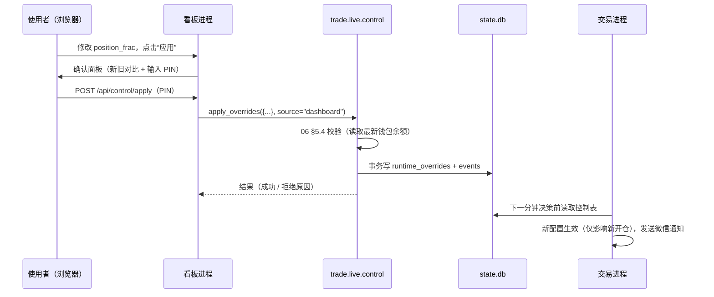

# 10 可视化看板（电脑经 SSH 隧道访问，深色 iOS 风格）

> 要点：不购买域名、不对公网开放看板；手机端只接收微信推送（07 §8）；看板采用 FastAPI + 静态前端，深色 iOS 风格，带全市场扫描动画。总览页草图见 [assets/dashboard-overview.svg](./assets/dashboard-overview.svg)，实现以草图的布局为准。

## 1. 目标与形态

- 网页看板，代码在 `trade.dashboard`，只供使用者本人在**电脑浏览器**上使用。
- **只有深色主题**，不提供浅色或主题切换。风格参照 iOS / macOS 深色界面：毛玻璃卡片、大圆角、系统字体、克制的动效。
- **不对公网开放**：看板只监听 `127.0.0.1`，服务器不开放 22 以外的入站端口，电脑通过 SSH 端口转发访问（§2）。不使用域名、HTTPS 证书与反向代理。
- **手机**：只接收微信推送（WxPusher 主、企业微信备份，07 §8），不提供手机网页。手机上的紧急操作见 §5.3。
- 两种使用场景，同一套代码，按可用数据自动显示页面：

| 场景     | 运行位置     | 访问方式                                    | 数据来源                                                     | 可用页面   |
| :------- | :----------- | :------------------------------------------ | :----------------------------------------------------------- | :--------- |
| 研究     | 本地 Windows | 本机 `http://localhost:8501`                | `artifacts/reports`、`artifacts/models`、`data/`、`configs/` | 回测与研究 |
| 实盘监控 | 东京服务器   | 电脑 SSH 隧道后打开 `http://localhost:8501` | 状态库 `state.db`、`artifacts/live/` + 已同步的研究报告      | 全部页面   |

- 看板是**独立进程**，与交易进程只通过 SQLite 状态库交互（02 §1、§3 第 6 条）。看板崩溃、重启、关闭都不影响交易。
- **看板不调用币安 API**。账户数据（持仓、挂单、成交、余额、资金费）由交易进程通过用户数据流与对账写入状态库（07 §6），看板只读状态库。原因：看板与交易进程共用服务器 IP 的请求权重（09 §6），看板高频刷新会挤占交易进程的权重；且策略层信息（p 值、未开仓原因、出场类型、R 倍数、扫描状态）币安没有。唯一例外是“一键停机”，它调用与 `kill_switch.py` 相同的函数（07 §7.3）。

## 2. 启动与访问

```text
# 服务器（systemd 服务 trade-dashboard.service）
python -m trade.dashboard --config configs/dashboard.yaml        # 监听 127.0.0.1:8501

# 电脑：建立 SSH 隧道后用浏览器打开 http://localhost:8501
ssh -N -L 8501:127.0.0.1:8501 tokyo

# 本地研究
python -m trade.dashboard --config configs/dashboard.yaml        # 同一命令，无 state.db 时只显示研究页面
```

- 配置 `server.address` 必须为 `127.0.0.1`；校验发现 `0.0.0.0` 或其他地址时拒绝启动。
- 服务器上的研究页面需要的报告与模型元数据，由 `sync` 脚本从本地推送（02 §5.8）。
- `scripts/sync.ps1` 增加 `tunnel` 子命令，一条命令建立隧道并打开浏览器。

## 3. 技术栈

| 部分      | 选型                                                                                                   | 说明                                                                 |
| :-------- | :----------------------------------------------------------------------------------------------------- | :------------------------------------------------------------------- |
| 后端      | FastAPI + uvicorn（单进程）                                                                            | 只读状态库与报告文件，提供 JSON 接口；WebSocket 向浏览器推送增量更新 |
| 前端      | 静态 HTML + 手写 CSS（CSS 变量定义深色设计令牌）+ Alpine.js                                            | **不使用 Node 构建链**；文件放在 `src/trade/dashboard/static/`       |
| K 线图    | TradingView lightweight-charts（Apache 2.0）                                                           | 1m K 线、信号点、开平仓标记、止损阶梯线                              |
| 统计图表  | Plotly.js                                                                                              | 绩效与回测报告图表                                                   |
| 第三方 JS | 全部下载到 `static/vendor/`，锁定版本并在 `static/vendor/VERSIONS.txt` 记录版本与 SHA256，**不走 CDN** | 本地与服务器均可离线运行；国内网络下 CDN 不稳定                      |

- 不再使用 Streamlit：整页重绘不适合动画与实时推送。
- 服务端渲染只负责页面骨架，数据全部走 `/api/*` 与 `/ws`。页面不渲染任何来自外部或日志的 HTML（文本一律转义），防止事件内容注入。

## 4. 视觉规范（深色）

| 项     | 规范                                                                                                                                                                                        |
| :----- | :------------------------------------------------------------------------------------------------------------------------------------------------------------------------------------------ |
| 背景   | `#08090D` 底色 + 两处低饱和径向渐变光斑（蓝 `#0A84FF`、紫 `#5E5CE6`，透明度 ≤ 15%）                                                                                                         |
| 卡片   | 半透明 `rgba(28,28,32,0.72)` + `backdrop-filter: blur(24px)`，1 px 细描边 `rgba(255,255,255,0.08)`，圆角 18 px                                                                              |
| 文字   | 主色 `#F5F5F7`，次级 `#8E8E93`，三级 `#636366`；字体栈 `-apple-system, "SF Pro Display", "PingFang SC", "Microsoft YaHei", sans-serif`；数字用等宽数字 `font-variant-numeric: tabular-nums` |
| 语义色 | 盈利/通过 `#30D158`，亏损/告警 `#FF453A`，信息/预过滤 `#0A84FF`，提示/观察中 `#FF9F0A`，影子盘标签橙色，实盘标签红色                                                                        |
| 动效   | 过渡 200~300 ms，`cubic-bezier(0.2, 0.8, 0.2, 1)`；数字变化用滚动过渡；尊重系统“减少动态效果”设置（`prefers-reduced-motion` 时关闭非必要动画）                                              |
| 布局   | 最小宽度 1280 px；左侧栏固定 220 px；内容区 12 栅格，卡片间距 16 px                                                                                                                         |

- 所有时间显示为北京时间（`display_tz`），悬停提示同时显示 UTC。金额单位 USDT，保留 4 位小数；比例显示为百分比；R 倍数保留 2 位。

## 5. 页面设计

### 5.0 公共框架

- **左侧栏**：6 个页面入口（总览、持仓与挂单、交易记录、绩效、回测与研究、控制）；底部连接状态：行情 WS、用户数据流、请求权重用量、微信推送最近一次成功时间，以及“SSH 隧道 · 127.0.0.1:8501”。
- **顶栏**：运行模式标签（paper / shadow / live，shadow 橙色、live 红色）、进程心跳（距今秒数，> 120 秒标红）、模型 ID、仓位设置（如“20% × 5x · 最多 3 仓”）、安全模式 / 停机状态（异常时整条顶栏变红）、北京时间与 UTC 双时钟、距下一根 K 线收盘的倒计时。
- 权益距权益下限（06 §5.3）不足 20% 时，顶栏下方显示橙色提示条。

### 5.1 总览（`overview`，见草图）

| 区域       | 内容                                                                                                                                            | 数据                                          |
| :--------- | :---------------------------------------------------------------------------------------------------------------------------------------------- | :-------------------------------------------- |
| 4 张指标卡 | 权益（钱包余额 + 未实现盈亏，附今日迷你曲线）；今日盈亏（附与日亏损停止线的距离）；持仓数（附保证金占用环）；今日笔数（胜/负、PF、单笔期望 bp） | `equity_snapshots`、`positions`、`risk_state` |
| 全市场扫描 | §6 的扫描网格，占内容区左侧约一半                                                                                                               | `scan_state`、`scan_cycles`                   |
| 权益曲线   | 1D / 1W / 1M / 全部；悬停显示数值；曲线下方渐变填充；回撤阴影按盯市权益（06 §5.1）                                                              | `equity_snapshots`                            |
| 当前持仓   | 每仓一张卡：币、浮盈（R 与 USDT）、止损类型（初始 / 保本 / 追踪）、止损上移阶梯迷你图、入场价 / 止损价 / 封顶价、持仓分钟进度条（相对 `H_max`） | `positions`                                   |
| 挂单       | 每张止损单与止盈单：类型、触发价 / 限价、数量、状态；追踪改单显示序号 `S{n}` 与“先挂新后撤旧”状态；**止损单不是“有效”时红色告警**               | `orders`                                      |
| 事件       | 最近 20 条：开仓、改单、未开仓原因、出场、新进入的币、告警；已推送微信的事件带标记                                                              | `events`                                      |

### 5.2 持仓与挂单（`positions`）

- 当前持仓表：币、入场时间、入场价、数量、名义价值、保证金、杠杆、当前止损价与类型、封顶止盈价、最高价 HH、现价、浮盈（R 与 USDT）、改单次数、剩余持仓分钟、止损单状态。
- 选中某个持仓：右侧展开 K 线（lightweight-charts），叠加入场点、止损阶梯线（每次上移的时刻与原因）、封顶止盈线、HH 轨迹。
- 当前挂单表：全部 `trd-` 前缀订单与条件单，状态、价格、数量、创建与更新时间；非本程序下的订单单独列出并提示（07 §6.2 对账）。
- 数据：`positions`、`orders`、`artifacts/live/bars/`。WebSocket 推送，订单或持仓变化后 1 秒内刷新。

### 5.3 交易记录（`trades`）

- 全部已平仓交易（`positions` 中 `status = CLOSED`，**永久保留，不清理**）：入场 / 出场时间、币、入场价、出场价、出场类型、持仓分钟、R 倍数、净盈亏、手续费、资金费、改单次数、p、m、模型 ID。
- 筛选：时间范围、币、出场类型、盈亏方向、模型 ID；排序；导出 CSV。
- 点开单笔：K 线回放（信号 K 线、入场、每次止损上移、出场），以及该笔的订单与成交明细（`orders`、`fills`）。
- 未开仓的信号记录：`signals` 中 `p ≥ θ` 但未开仓的分钟及原因（冷却、持仓上限、追价、日亏损停止等），可筛选。
- 历史完整性：成交与资金费由用户数据流实时写入；对账时用 `GET /fapi/v1/userTrades` 与 `GET /fapi/v1/income` 补齐断线期间的缺口（07 §6.2）。币安这两类接口单次只能查最近 7 天，因此**补齐必须在缺口发生后 7 天内完成**，否则缺口只能以对账告警的形式保留。

### 5.4 绩效（`performance`）

- 时间范围：今日 / 7 天 / 30 天 / 全部 / 自定义。
- 指标卡：净盈亏、胜率、Profit Factor、单笔期望（bp 与 R）、最大回撤（盯市）、手续费合计、资金费合计。
- 图表：日盈亏柱状图；累计权益曲线叠加回测期望区间带（回测测试段同长度窗口收益的 10~90 分位）；按币盈亏；按出场类型占比；MFE 与回吐比例；按北京时间小时的盈亏热力图；按交易范围角色（训练组 / 留出组 / 新进入）分组。
- 实盘 vs 回测：滑点与价差实测 / 模型比值趋势、信号一致率趋势、特征 PSI 告警列表（07 §8.6 的每日结果）。
- 数据：`positions`、`fills`、`artifacts/live/daily/`、上线模型对应的回测 `summary.json`。手动刷新或 60 秒。

### 5.5 回测与研究（`research`）

两个标签页：

- **回测报告**：选择 `artifacts/reports/{run_id}`（按时间倒序，标注 `--final` 运行）；顶部 `gate.json` 闸门判定（每项通过 / 未通过、实际值与标准值，含统计显著性）；reference / user 两次运行 × 三情景指标对比（`summary.json`）；权益曲线与回撤、月度收益、按币收益、概率校准、盈亏平衡滑点；`sizing_sweep` 表格与叠加曲线；S1~S11 结果表（S9 标注覆盖范围）与回测真实性审查清单（06 §9）；交易与放弃信号明细；两个 run 并排对比。
- **数据与模型**：选择月份查看交易范围快照（入选币、排名、30 天日成交额中位数、角色）；各月入选数量与进出名单（`universe_report.md`）；`universe.yaml` 规则参数与 `reviewed`；数据质量（03 §2.4，按 30 天窗口）；数据集保留率与正样本率（`manifest.json`，含标签模式）；模型列表、训练曲线、分类指标、R0/M0/M1/M2 对比。

### 5.6 控制（`control`）

| 区块         | 内容                                                                                                                                                                                 |
| :----------- | :----------------------------------------------------------------------------------------------------------------------------------------------------------------------------------- |
| 当前生效配置 | 模式、`position_frac`、`max_positions`、杠杆、单笔亏损上限、日亏损与回撤阈值；每项标注来源（配置文件 / 覆盖），以及 06 §5.4 的“仓位设置摘要”（按钱包余额算出的单笔保证金与名义价值） |
| 参数调节     | 07 §7.1.1 白名单内的参数；修改后**实时预览**新的仓位设置摘要和校验结果，不通过时“应用”按钮禁用并显示原因                                                                             |
| 恢复默认     | “清除所有覆盖”（等同 `set_sizing.py --reset`）                                                                                                                                       |
| 一键停机     | 红色按钮，等同 `kill_switch.py`（07 §7.3）                                                                                                                                           |
| 操作记录     | `events` 中 `source = dashboard` / `cli` 的控制操作历史                                                                                                                              |

看板**不提供**清除停机标志、切换运行模式（paper/shadow/live）、修改风控白名单以外参数的功能。

## 6. 全市场扫描（总览页核心组件）

**所有动画都由交易进程实际写入状态库的数据驱动，不做装饰性假动画。**

### 6.1 数据

交易进程每分钟处理交易范围内全部币时，写入（07 §6.1）：

- `scan_cycles`：每根 K 线一行——`open_time`、`started_ms`、`finished_ms`、`n_symbols`、`n_prefilter`、`n_signal`、`n_opened`。
- `scan_state`：每币一行（覆盖更新）——`symbol`、`alias`、`open_time`、`seq`（本轮处理顺序）、`status`（`tradable` / `watching` 新进入观察中 / `exit_only` 已退出仅持仓 / `blocked` 交易规则或预热不满足）、`prefilter`（0/1）、`p`、`m`、`decision`（`open` / `skip` / `none`）、`skip_reason`、`spread_bp`、`processed_ms`。

### 6.2 交互与动画

1. **每根 K 线收盘**：网格顶部进度条从左向右扫过，时长按 `scan_cycles.finished_ms − started_ms` 实际耗时；格子按 `seq` 顺序依次点亮，与交易进程处理顺序一致。浏览器断线重连时直接显示最新状态，不补播动画。
2. **当前正在处理的币**：白色描边 + 外发光；尚未处理到的格子为暗色。
3. **格子状态**：

| 状态                    | 样式                               |
| :---------------------- | :--------------------------------- |
| 未通过预过滤            | 暗灰                               |
| 通过预过滤              | 蓝色，圆环按 p 值填充              |
| `p ≥ θ`                 | 绿色 + 柔和发光                    |
| 已下单（本轮开仓）      | 绿色 + 外圈脉冲动画（约 2 秒）     |
| 有信号但未开仓          | 橙色虚线框，悬停显示 `skip_reason` |
| 已有持仓                | 绿色描边                           |
| 新进入观察中            | 橙点 + “观察中”                    |
| 已退出仅持仓 / 不可交易 | 灰色描边 + 标签                    |

4. **悬停**：显示币名、p、m、价差、本轮处理耗时、状态说明。
5. **点击**：弹出该币最近 6 小时的 K 线抽屉，叠加信号点（按 p 着色，`p ≥ θ` 用三角）、开平仓标记与止损阶梯线，以及成交额副图（主动买 / 主动卖堆叠）。
6. 网格右上角显示本轮统计：`扫描 60 · 预过滤 9 · 信号 2 · 开仓 1 · 用时 182 ms`。
7. **月度再平衡**当天（07 §3.5）：新进入的币以淡入出现，退出的币以淡出移除（仍有持仓的保留为“仅持仓”）。

## 7. 接口

| 接口                                         | 内容                                                                                        |
| :------------------------------------------- | :------------------------------------------------------------------------------------------ |
| `GET /api/status`                            | 模式、心跳、模型 ID、仓位设置、安全模式、连接状态、请求权重                                 |
| `GET /api/overview`                          | 指标卡、持仓、挂单、最近事件                                                                |
| `GET /api/scan`                              | 最新 `scan_cycles` 与全部 `scan_state`                                                      |
| `GET /api/equity?range=`                     | 权益曲线（自动降采样，最多 2000 点）                                                        |
| `GET /api/positions`、`/api/orders`          | 当前持仓、当前挂单                                                                          |
| `GET /api/trades?...`                        | 交易记录（分页，每页 ≤ 200 条）、CSV 导出                                                   |
| `GET /api/klines?symbol=&from=&to=`          | 来自 `artifacts/live/bars/` 的 K 线与叠加标记（最多 720 根，更长自动重采样为 5m）           |
| `GET /api/performance?range=`                | 绩效统计                                                                                    |
| `GET /api/reports`、`/api/reports/{id}`      | 回测报告与研究数据（只读文件）                                                              |
| `POST /api/control/preview`                  | 仓位调整预览（不写入）                                                                      |
| `POST /api/control/apply`、`/reset`、`/kill` | 控制操作（§8）                                                                              |
| `WS /ws`                                     | 推送：`status`（5 秒）、`scan`（每轮扫描完成）、`positions` / `orders` / `events`（变化时） |

- WebSocket 推送由看板进程轮询状态库实现（每秒查询变更时间戳），交易进程不感知看板。
- 所有查询带时间范围与行数上限。

## 8. 控制操作的实现



- `trade.live.control` 提供：`get_effective_sizing()`、`preview(overrides)`、`apply_overrides(overrides, source)`、`reset_overrides(source)`、`kill_switch(source)`。CLI 与看板都只调用这些函数。
- **二次确认**：所有写操作弹出确认面板，展示新旧值对比，并要求输入环境变量 `DASHBOARD_CONTROL_PIN` 中设置的 PIN；PIN 未设置时看板以只读模式运行，控制页按钮全部禁用。“一键停机”同样需要 PIN，面板默认聚焦确认按钮以便快速操作。
- PIN 比较使用常量时间比较（`hmac.compare_digest`）；连续 5 次错误后锁定控制功能 15 分钟。
- 每次写操作在 `events` 记录：时间、操作、新旧值、来源、结果。
- 交易进程未运行（心跳超时）时，控制页显示警告：设置会写入但要等交易进程启动后才生效；一键停机仍可执行（直接通过 REST）。

## 9. 安全

- **网络**：看板只监听 `127.0.0.1`；服务器入站只开放 22（SSH 密钥登录，02 §5.5）；访问看板必须先有服务器的 SSH 权限。
- **请求校验**：所有 `POST` 与 WebSocket 连接校验 `Host` 为 `localhost:8501` 或 `127.0.0.1:8501`、`Origin`（如有）同源，拒绝其他来源，防止 DNS 重绑定与跨站请求。
- **PIN**：所有控制操作二次确认、失败锁定（§8）。
- **功能白名单**：永远不提供清除停机标志、切换运行模式、修改风控白名单以外参数的功能（§5.6）。
- 看板进程不读取、不显示 API Secret / 私钥；需要调用 REST 的一键停机由 `trade.live.control` 在进程内读取环境变量，不经过页面。
- 状态库以只读 URI（`file:state.db?mode=ro`）打开用于查询；写操作只在 `trade.live.control` 内用单独连接完成。

### 9.1 手机上的紧急操作（无手机看板）

1. **微信推送**：告警、停机、开平仓实时推送到个人微信，企业微信备份（07 §8）。
2. **手机 SSH**：手机安装 SSH 客户端（如 Termius），执行 `python scripts/kill_switch.py`（需要 PIN 之外的 SSH 密钥，手机上的私钥需设置密码）。
3. **币安 App**：最终手段，直接手动平仓、撤单。止损单始终挂在交易所，服务器断线时仓位仍受保护（07 §7.4）。

## 10. 性能

- 看板 CPU 占用目标：服务器上常驻时 < 5%（2 vCPU），无浏览器连接时 < 1%；不得影响交易进程延迟。交易进程延迟 P95 因看板运行而上升 > 20 ms 时，降低推送频率。
- 状态库 WAL 模式，看板只读连接不阻塞交易进程写入。
- 查询结果按接口缓存（实时类 1~5 秒、研究类 10 分钟）；回测 Parquet 用 pyarrow 按列读取。
- 前端动画只用 CSS `transform` 与 `opacity`，60 个格子的动画不触发页面重排。

## 11. 配置 `configs/dashboard.yaml`

```yaml
server:
  address: 127.0.0.1 # 只允许 127.0.0.1；访问经 SSH 隧道
  port: 8501
paths:
  state_db: ./artifacts/live/state.db # 不存在则隐藏实盘页面
  live_dir: ./artifacts/live
  reports_dir: ./artifacts/reports
  models_dir: ./artifacts/models
push_sec:
  status: 5
  db_poll: 1 # WebSocket 推送前查询状态库变更的间隔
cache_sec:
  realtime: 2
  research: 600
display:
  tz: Asia/Shanghai
  amount_decimals: 4
  kline_max_bars: 720
  equity_max_points: 2000
control:
  enabled: true # false 时整个看板只读
  pin_env: DASHBOARD_CONTROL_PIN
  max_pin_failures: 5
  lock_minutes: 15
```

## 12. 测试

- `queries`：用 `tests/fixtures/state_sample.db`（手工构造的小状态库，含 `scan_state`、`scan_cycles`）测试每个查询的结果与边界（空库、无持仓、跨日、再平衡当天）。
- `control`：校验拒绝（比例 × 持仓数 > 0.95、强平距离不足）、成功写入、来源记录、PIN 错误锁定。
- 安全：配置为 `0.0.0.0` 时拒绝启动；`Host` / `Origin` 不合法的 POST 与 WebSocket 被拒绝；页面对事件文本中的 HTML 做了转义。
- 接口冒烟：用 FastAPI `TestClient` 逐个请求全部 `/api/*` 与 `/ws`，分别在“仅研究数据”和“研究 + 实盘数据”两种 fixture 下运行，断言无异常、字段齐全。
- 前端：`static/vendor/VERSIONS.txt` 中的 SHA256 与文件一致的测试；手工验收按 08 §2 P6（含与草图的布局对照）。
