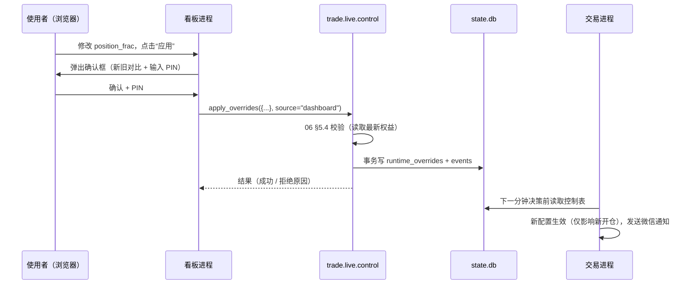

# 10 可视化看板（服务器部署，电脑与手机可访问）

## 1. 目标与形态

- 网页看板，用 **Streamlit + Plotly** 实现，代码在 `trade.dashboard`。实盘看板部署在东京服务器上，经 Caddy 提供 `https://<你的域名>` 访问，**手机浏览器不开 VPN 即可打开**（02 §5.6）。
- 两种使用场景，同一套代码，按可用数据自动显示页面：

| 场景     | 运行位置     | 访问方式                                   | 数据来源                                                     | 可用页面             |
| :------- | :----------- | :----------------------------------------- | :----------------------------------------------------------- | :------------------- |
| 研究     | 本地 Windows | 本机 `http://localhost:8501`               | `artifacts/reports`、`artifacts/models`、`data/`、`configs/` | 回测报告、数据与模型 |
| 实盘监控 | 东京服务器   | 手机 / 电脑 `https://<域名>`（Caddy 认证） | 状态库 `state.db`、`artifacts/live/` + 已同步的研究报告      | 全部页面（含手机页） |

- 看板是**独立进程**，与交易进程只通过 SQLite 状态库交互（02 §1、§3 第 6 条）。看板崩溃、重启、关闭都不影响交易。
- 看板不直接调用币安下单接口。唯一例外是“一键停机”，它调用与 `kill_switch.py` 相同的函数（07 §7.3）。

## 2. 启动方式

```text
# 本地研究
streamlit run src/trade/dashboard/app.py --server.address 127.0.0.1 --server.port 8501 -- --config configs/dashboard.yaml

# 服务器（systemd 服务 trade-dashboard.service；对外由 caddy.service 提供 HTTPS）
streamlit run src/trade/dashboard/app.py --server.address 127.0.0.1 --server.port 8501 --server.headless true -- --config configs/dashboard.yaml
# 手机 / 电脑浏览器打开 https://<域名>，先通过 Caddy 的 basic_auth 登录

# 备用：没有域名或 443 不可用时，电脑上用 SSH 端口转发
ssh -N -L 8501:127.0.0.1:8501 tokyo
# 然后浏览器打开 http://localhost:8501
```

- `--server.address` 必须为 `127.0.0.1`，配置校验发现 `0.0.0.0` 或公网地址时拒绝启动。公网入口只能是 Caddy。
- 服务器上的研究页面需要的报告与模型元数据，由 `sync` 脚本从本地推送（02 §5.8）。
- Streamlit 的使用统计上报关闭（`browser.gatherUsageStats = false`，写在 `.streamlit/config.toml`）。

## 3. 页面设计

所有时间显示为北京时间（`display_tz`），悬停提示中同时显示 UTC。金额单位 USDT，保留 4 位小数（小本金下 2 位不够看）；比例显示为百分比。

页面左侧边栏固定显示：运行模式（paper / shadow / live，live 用红色标签）、当前仓位比例与杠杆（如“20% × 5x”）、进程心跳（最近一次心跳距今秒数，> 120 秒标红）、安全模式 / 停机状态。

### 3.1 总览（`overview`）

```text
┌──────────┬──────────┬──────────┬──────────┬──────────┐
│ 当前权益  │ 今日盈亏  │ 累计盈亏  │ 持仓数    │ 今日笔数  │
│ 10.8421  │ +0.3120  │ +0.8421  │ 1 / 1    │ 7 (胜 4) │
├──────────┴──────────┴──────────┴──────────┴──────────┤
│ 实时权益曲线（equity_snapshots，可选 1天/7天/全部）       │
├───────────────────────────────┬──────────────────────┤
│ 当前持仓卡片（币、方向、入场价、 │ 风控状态：R5~R8 当前值 │
│ 现价、浮盈、U/D 距离、剩余分钟）│ 与阈值的进度条         │
├───────────────────────────────┴──────────────────────┤
│ 最近事件（events 最近 20 条，告警高亮）                   │
└──────────────────────────────────────────────────────┘
```

- 数据：`equity_snapshots`、`positions`、`risk_state`、`events`。
- 刷新：`st.fragment(run_every="5s")` 局部刷新，不整页重载。
- 权益距权益下限（06 §5.3）不足 20% 时，顶部显示橙色提示条。

### 3.2 行情与信号（`market`）

- 选择币种（默认当前持仓币，否则 p 值最高的币）与时间范围（默认最近 6 小时）。
- 主图：1m K 线（Plotly Candlestick），叠加：
  - 信号点：通过预过滤的分钟按 p 值着色的散点；`p ≥ θ` 的用三角标出；未开仓的悬停显示 `skip_reason`。
  - 开仓 / 平仓标记（绿三角 / 红三角或灰方块表示超时），持仓期间画止损价阶梯线（随保本 / 追踪上移）与封顶止盈线。
- 副图：成交额柱状图（主动买 / 主动卖堆叠）、p 值折线与阈值 θ 虚线。
- 右侧表格：全部交易币当前一分钟的 p、是否通过预过滤、价差、最近一次开仓时间。
- 数据：`artifacts/live/bars/`、`signals`、`positions`。刷新：10 秒。

### 3.3 持仓与订单（`positions`）

- 当前持仓表：币、入场时间、入场价、数量、名义价值、保证金、杠杆、当前止损价与类型（初始/保本/追踪）、封顶止盈价、最高价 HH、现价、浮盈（R）、改单次数、剩余持仓分钟、止损单状态（必须为“有效”，否则红色告警）。
- 当前挂单表：`trd-` 前缀订单与条件单，状态、价格、数量。
- 最近 100 笔订单与成交（可筛选币种、类型）。
- 数据：`positions`、`orders`、`fills`。刷新：5 秒。

### 3.4 绩效（`performance`）

- 时间范围选择：今日 / 7 天 / 30 天 / 全部 / 自定义。
- 指标卡：净盈亏、胜率、Profit Factor、单笔期望、最大回撤、手续费合计、资金费合计。
- 图表：日盈亏柱状图、累计权益曲线（叠加回测期望区间带：回测测试段同长度窗口收益的 10~90 分位）、按币盈亏、按出场类型（初始止损/保本/追踪/封顶止盈/无进展/超时）占比、MFE 与回吐比例、按北京时间小时的盈亏热力图。
- 实盘 vs 回测：滑点与价差实测 / 模型比值趋势、信号一致率趋势、特征 PSI 告警列表（来自 07 §8.6 的每日结果）。
- 交易明细表，可导出 CSV。
- 数据：`positions`、`fills`、`artifacts/live/daily/`、上线模型对应的回测 `summary.json`。刷新：手动或 60 秒。

### 3.5 控制（`control`）

| 区块         | 内容                                                                                                                                                                                   |
| :----------- | :------------------------------------------------------------------------------------------------------------------------------------------------------------------------------------- |
| 当前生效配置 | 模式、`position_frac`、`max_positions`、杠杆、单笔亏损上限、日亏损与回撤阈值；每项标注来源（配置文件 / 覆盖），以及 06 §5.4 的“仓位设置摘要”（含按当前权益算出的单笔保证金与名义价值） |
| 参数调节     | 07 §7.1.1 白名单内的参数，用滑块 / 数字框；修改后**实时预览**新的仓位设置摘要（单笔名义价值、止损时亏损区间、满仓保证金占用、权益下限）和校验结果，不通过时“应用”按钮禁用并显示原因    |
| 恢复默认     | “清除所有覆盖”按钮（等同 `set_sizing.py --reset`）                                                                                                                                     |
| 一键停机     | 红色按钮，等同 `kill_switch.py`（07 §7.3）                                                                                                                                             |
| 操作记录     | `events` 中 `source = dashboard` / `cli` 的控制操作历史                                                                                                                                |

确认机制见 §4。看板**不提供**清除停机标志、切换运行模式（paper/shadow/live）、修改风控白名单以外参数的功能。

### 3.6 回测报告（`backtest`）

- 下拉选择 `artifacts/reports/{run_id}`，按时间倒序，标注是否为 `--final` 运行。
- 顶部：`gate.json` 闸门判定（每项通过 / 未通过、实际值与标准值）。
- 两次运行（reference / user）与三情景（base / stress / hell）的指标对比表（`summary.json`）。
- 交互式图表（读取 `equity.parquet`、`trades.parquet`）：权益曲线与回撤、月度收益、按币收益、概率校准图、盈亏平衡滑点。
- 仓位比例敏感性：`sizing_sweep.parquet` 的表格 + 各比例权益曲线叠加图，帮助使用者选择 `position_frac`。
- 健全性检验 S1~S11 结果表与回测真实性审查清单（06 §9）；S1 随机基准分布直方图与策略结果竖线。
- 交易明细与放弃信号明细（`skipped.parquet`）可筛选、可导出。
- 两个 run 对比模式：选择两个 run_id，并排显示核心指标与权益曲线。

### 3.7 数据与模型（`research`）

- 币种名单：`coins.yaml` 表格（训练 / 留出 / 盲测 / 排除、板块、来源、校验结果）；是否已审阅（`reviewed`）。
- 数据质量：每币缺失率、一致性误差、价格跳变次数（03 §2.4）。
- 数据集：样本保留率、正样本率（`manifest.json`）。
- 模型：模型列表（`model_meta.json`），训练曲线（`train_log.csv`：损失、PR-AUC），分类指标（`eval.json`），R0/M0/M1/M2 对比。

### 3.8 手机页（`mobile`）

手机竖屏上 Streamlit 的多列布局会被压成单列、图表偏小，因此单独提供一个精简页，手机访问时（按 User-Agent 或屏幕宽度判断，也可手动切换）默认打开：

- 顶部状态条：运行模式、心跳、安全模式 / 停机状态（异常时整条变红）。
- 4 个数字：当前权益、今日盈亏、持仓数、今日笔数。
- 当前持仓卡片（每仓一张）：币、浮盈（R 与 USDT）、当前止损价与类型（初始 / 保本 / 追踪）、剩余分钟。
- 最近 10 条事件。
- 小尺寸权益曲线（今日）。
- 两个按钮：“一键停机”（红色，需 PIN）、“调整仓位比例”（只开放 `position_frac` 与 `max_positions`，需 PIN）。
- 刷新：10 秒；数据量控制在每次刷新 < 50 KB，适合移动网络。

## 4. 控制操作的实现



- `trade.live.control` 提供：`get_effective_sizing()`、`preview(overrides)`、`apply_overrides(overrides, source)`、`reset_overrides(source)`、`kill_switch(source)`。CLI 与看板都只调用这些函数。
- **二次确认**：所有写操作弹出确认对话框（`st.dialog`），展示新旧值对比，并要求输入环境变量 `DASHBOARD_CONTROL_PIN` 中设置的 PIN；PIN 未设置时看板以只读模式运行，控制页按钮全部禁用。“一键停机”同样需要 PIN，但对话框中默认聚焦确认按钮以便快速操作。
- PIN 比较使用常量时间比较（`hmac.compare_digest`）；连续 5 次错误后锁定控制功能 15 分钟。
- 每次写操作在 `events` 记录：时间、操作、新旧值、来源、结果。
- 交易进程未运行（心跳超时）时，控制页显示警告：设置会写入但要等交易进程启动后才生效；一键停机仍可执行（直接通过 REST）。

## 5. 安全

- Streamlit 只监听 `127.0.0.1`；公网只通过 Caddy（443）访问（02 §5.6）。安全边界分三层：
  1. **Caddy basic_auth**：强密码（≥ 16 位随机），只存 bcrypt 哈希；fail2ban 对连续认证失败的 IP 封禁 1 小时；
  2. **看板 PIN**：所有控制操作二次确认、失败锁定（§4）；
  3. **功能白名单**：看板永远不提供清除停机标志、切换运行模式、修改风控白名单以外参数的功能（§3.5），即使前两层被突破，攻击者最多只能停机或在校验范围内调整仓位比例。
- 强制 HTTPS（HSTS），不在 URL 中携带任何凭据。
- 若担心公网暴露，可在 `dashboard.yaml` 中设置 `control.remote_enabled: false`：经 Caddy 访问时只读（一键停机除外），控制操作只能在 SSH 端口转发访问时进行（看板根据请求头 `X-Forwarded-For` 是否存在区分来源）。
- 看板进程不读取、不显示 API Secret / 私钥；需要调用 REST 的一键停机由 `trade.live.control` 在进程内读取环境变量，不经过页面。
- 状态库以只读 URI（`file:state.db?mode=ro`）打开用于查询；写操作只在 `trade.live.control` 内用单独连接完成。
- 页面不渲染任何来自外部的 HTML（不使用 `unsafe_allow_html`），防止日志或事件内容注入。

## 6. 性能

- 查询集中在 `trade.dashboard.queries`，每个查询带时间范围与行数上限（默认 5000 行），并用 `st.cache_data(ttl=...)` 缓存（实时页 3~5 秒，研究页 10 分钟）。
- K 线图默认最多显示 720 根（12 小时），更长范围自动重采样为 5m。
- 回测 Parquet 用 pyarrow 按列读取，只读需要的列。
- 看板 CPU 占用目标：服务器上常驻时 < 5%（2 vCPU），不得影响交易进程延迟；交易进程延迟 P95 因看板运行而上升 > 20 ms 时，应降低刷新频率。

## 7. 配置 `configs/dashboard.yaml`

```yaml
server:
  address: 127.0.0.1 # 只允许 127.0.0.1；公网入口由 Caddy 提供
  port: 8501
  behind_proxy: true # 服务器上经 Caddy 访问时为 true
paths:
  state_db: ./artifacts/live/state.db # 不存在则隐藏实盘页面
  live_dir: ./artifacts/live
  reports_dir: ./artifacts/reports
  models_dir: ./artifacts/models
refresh_sec:
  overview: 5
  market: 10
  positions: 5
  performance: 60
display:
  tz: Asia/Shanghai
  amount_decimals: 4
  kline_max_bars: 720
control:
  enabled: true # false 时整个看板只读
  pin_env: DASHBOARD_CONTROL_PIN
  max_pin_failures: 5
  lock_minutes: 15
  remote_enabled: true # false：经 Caddy 访问时只读（一键停机除外）
mobile:
  refresh_sec: 10
  auto_detect: true
```

## 8. 测试

- `queries`：用 `tests/fixtures/state_sample.db`（手工构造的小状态库）测试每个查询的结果与边界（空库、无持仓、跨日）。
- `control`：校验拒绝（比例 × 持仓数 > 0.95、强平距离不足）、成功写入、来源记录、PIN 错误锁定。
- 页面冒烟：使用 Streamlit 自带的 `streamlit.testing.v1.AppTest` 逐页加载，断言无异常、关键组件存在；分别在“仅研究数据”和“研究 + 实盘数据”两种 fixture 下运行。
- 手工验收：08 §2 P6 的看板验收项。
