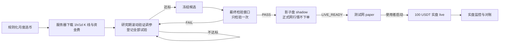

# 币安 USDⓈ-M 永续多策略研究与实盘工具 —— 设计书总览

> 状态：定版
> 本文件是整套设计书的入口。当前工作按 `指令/自动多轮/` 下的指令执行，目标与风险包络见 [00-当前目标.md](./00-当前目标.md)。

## 1. 一句话描述

基于**币安**的公开历史数据与 USDⓈ-M 永续合约 API，在**规则化月度选币**得到的交易范围上（03 §4），按预登记的策略方向一轮一轮自动研究：研究期用滚动验证调参并登记全部试验，达标策略冻结为候选，交给一个从未读取过的最终检验窗口检验一次，通过后依次进入影子盘、测试网与使用者本人启动的 100 USDT 小资金实盘。允许做多与做空，5x 逐仓。

**网络原则：使用者在中国大陆、不依赖 VPN。** 所有访问币安的流量（历史数据下载、行情、下单）都只发生在**腾讯云东京服务器**上；本地 Windows 只通过 SSH 与服务器交互。看板部署在服务器上、只监听 127.0.0.1，电脑经 SSH 隧道访问，不对公网开放；通知推到个人微信（WxPusher），企业微信群机器人作备份。

## 2. 端到端流程

各阶段的判定标准写在 `docs/13-研究框架.md`；实盘与风控在 `docs/07`，币安接口在 `docs/09`，看板在 `docs/10`。

## 3. 文档清单

| 序号 | 文档 | 内容 | 主要读者 |
| :--- | :--- | :--- | :--- |
| 00 | [00-当前目标.md](./00-当前目标.md) | 目标、市场与风险包络、研究与验证流程、交接文件位置 | 所有人 |
| 02 | [02-系统架构与部署.md](./02-系统架构与部署.md) | 模块划分、目录结构、技术栈、大陆网络下的部署与同步、配置规范 | 开发/运维 |
| 03 | [03-数据与选币.md](./03-数据与选币.md) | 历史数据下载、存储、数据质量、规则化月度选币 | 开发 |
| 07 | [07-实盘与风控.md](./07-实盘与风控.md) | 实盘引擎、下单与止损、风控、对账、运行中调节、通知、安全 | 开发/运维 |
| 09 | [09-币安数据与API.md](./09-币安数据与API.md) | 用到的全部币安数据与接口、API Key、签名、限频、费率核对 | 开发 |
| 10 | [10-可视化看板.md](./10-可视化看板.md) | 网页看板：页面、控制、安全、性能（草图 dashboard-overview.svg） | 开发 |
| 13 | [13-研究框架.md](./13-研究框架.md) | 研究数据层、策略接口、组合层、执行模拟、滚动验证、指标、守卫 | 开发/研究 |
| — | `docs/research/` | 任务交接文件：总账、轮次、候选、最终检验、影子盘、实盘记录 | 所有 Agent |
| — | [../AGENTS.md](../AGENTS.md) | 通用工程规范：代码、注释、文档同步、量化红线、Git、完成报告 | 开发/Agent |

已结束的旧策略文档（`01`、`04`、`05`、`06`、`08`、`11`、旧 `records`/`tasks`/回测结果/轮动记录/选币报告）在 [docs/archive/](./archive/README.md)，只供查阅，不代表当前规格。

## 4. 关键决策速查

| 项目 | 决策 | 详见 |
| :--- | :--- | :--- |
| 数据与交易所 | 全部基于币安：历史数据 data.binance.vision，实时与交易用 USDⓈ-M 合约 API | 09 |
| 交易市场 | **仅 USDⓈ-M 永续合约**、单向持仓、逐仓、**5x**，允许做多与做空 | 00 §2 |
| 网络 | 本地（中国大陆 IP）不直连币安；一切币安流量在东京服务器上发生；本地 ↔ 服务器只用 SSH（含 git、rsync） | 02 §5 |
| 本金与仓位 | 初始 **100 USDT**；`fixed_risk`，单笔风险 0.005~0.01，`position_frac` 0.08，`max_positions` 10；总名义 ≤ 权益 × 2，净敞口 ≤ 权益 × 1 | 00 §2、13 |
| 手续费 | **VIP0**，不用 BNB 抵扣；启动时读取账户实际费率核对 | 09 §4、07 |
| 通知 | **个人微信**（WxPusher，主）；企业微信群机器人（备份）；飞书可选 | 07 §8 |
| 可视化 | FastAPI + 静态前端看板，部署在东京服务器、只监听 127.0.0.1，**电脑经 SSH 隧道访问**；看板不调用币安 API | 10 |
| 币种 | **规则化月度选币**：每月按 30 天日成交额中位数取山寨币 USDT 永续（规则见 `configs/universe.yaml`），研究、最终检验、实盘同一函数 | 03 §4 |
| 验证 | 研究期滚动验证（多折拼接的样本外曲线）→ 最终检验窗口只检验一次 → 影子盘 → 测试网 → 实盘 | 00 §3、13 |
| 决策频率 | 小时级调仓（按策略声明的调仓时刻表），持仓数个到十几个 | 13 |
| 单一实现 | 策略、组合层、执行口径、止损与取整在研究、最终检验、影子盘、实盘中共用同一份代码 | 13、07 |
| 实盘部署 | **腾讯云 东京地域**（2 核 / 3.6 GB），固定公网 IP，交易程序、看板、数据下载都运行在该服务器上；安全组只开放 22 | 02 §5 |

## 5. 参考依据

- Marcos López de Prado《Advances in Financial Machine Learning》：Purged K-Fold 与 Embargo、样本独特性权重、组合净化。
- Bailey & López de Prado《The Deflated Sharpe Ratio》：多次试验后对夏普的折扣（13 的指标定义）。
- 社区普遍结论：币安撮合部署于 AWS 东京区域（ap-northeast-1）。
- **GitHub 上没有经过公开验证“持续盈利”的同类策略项目**：借鉴的是工程成熟度（交易所对接、研究-实盘一致性、风控边界情况），不是收益。
