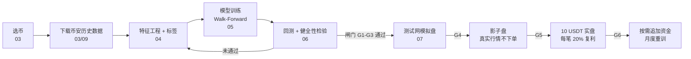

# 币安山寨币超短线做多量化工具 —— 设计书总览

> 版本：v1.3（2026-10-27） 状态：评审中
> 本文件是整套设计书的入口。实现方（人或 AI Agent）请按“阅读顺序”通读全部文档后再动手，任何与本文冲突的口头要求以最新版文档为准。

## 1. 一句话描述

基于**币安**的公开历史数据与 USDⓈ-M 永续合约 API，选出 15 个过去一年具有代表性的高流动性山寨币，用 PyTorch 训练一个“跨币种通用”的分钟级突破识别模型，只做多、5x 逐仓、持仓数分钟到 30 分钟；先经过严格的 Walk-Forward 回测和多道闸门，通过后依次进入测试网、影子盘、10 USDT 小资金实盘。配套 localhost 网页看板与飞书机器人通知。

## 2. 端到端流程

闸门（Gate）定义见 [08-开发计划与验收.md](./08-开发计划与验收.md)。任何一道闸门不通过都不允许进入下一阶段，这是本项目最重要的规则。看板（10）贯穿研究与实盘全过程。

## 3. 文档清单与阅读顺序

| 序号 | 文档                                            | 内容                                                                   | 主要读者   |
| :--- | :---------------------------------------------- | :--------------------------------------------------------------------- | :--------- |
| 00   | design.md（本文）                               | 总览、索引、关键决策速查、变更记录                                     | 所有人     |
| 01   | [01-需求与范围.md](./01-需求与范围.md)          | 背景、目标、非目标、已确认决策、术语、合规与风险                       | 所有人     |
| 02   | [02-系统架构与部署.md](./02-系统架构与部署.md)  | 模块划分、目录结构、技术栈、部署与网络（含不提供代理的原因）、配置规范 | 开发       |
| 03   | [03-数据与选币.md](./03-数据与选币.md)          | 历史数据下载、存储格式、数据质量、15 币选取算法、时间切分              | 开发       |
| 04   | [04-特征与标签.md](./04-特征与标签.md)          | 特征全集与公式、防未来函数规则、归一化、预过滤、三重障碍标签           | 开发/研究  |
| 05   | [05-模型与训练.md](./05-模型与训练.md)          | 模型选型理由、网络结构、训练流程、校准、阈值、导出与版本               | 开发/研究  |
| 06   | [06-回测引擎.md](./06-回测引擎.md)              | 成交假设、VIP0 成本、仓位与资金风控、指标、健全性检验、报告            | 开发/研究  |
| 07   | [07-实盘与风控.md](./07-实盘与风控.md)          | 启动流程、下单、风控 R1~R14、对账、运行中调节、飞书通知、安全          | 开发/运维  |
| 08   | [08-开发计划与验收.md](./08-开发计划与验收.md)  | 阶段 P0~P8、闸门 G1~G6、测试要求、给 Agent 的工作指令                  | 开发/Agent |
| 09   | [09-币安数据与API.md](./09-币安数据与API.md)    | 用到的全部币安数据与接口、API Key 创建、签名、限频、费率核对、冒烟测试 | 开发       |
| 10   | [10-可视化看板.md](./10-可视化看板.md)          | localhost 网页看板：页面、控制操作、安全、性能                         | 开发       |
| —    | [../AGENTS.md](../AGENTS.md)                    | 通用工程规范：代码、注释、文档同步、量化红线、Git、完成报告            | 开发/Agent |
| —    | [reports/\_TEMPLATE.md](./reports/_TEMPLATE.md) | 每次任务结束的中文完成报告模板                                         | 开发/Agent |

## 4. 关键决策速查

| 项目         | 决策                                                                                                     | 详见             |
| :----------- | :------------------------------------------------------------------------------------------------------- | :--------------- |
| 数据与交易所 | 全部基于币安：历史数据 data.binance.vision，实时与交易用 USDⓈ-M 合约 API                                 | 09               |
| 交易市场     | USDⓈ-M 永续合约、单向持仓、逐仓、**5x**、只做多                                                          | 01 §5            |
| 本金与仓位   | 初始 **10 USDT**；每笔保证金固定为**当前权益的 20%**（复利，最多 3 仓）；比例可在看板 / 命令行运行中调节 | 06 §5、07 §7.1.1 |
| 止损位       | 随 ATR 自适应，价格的 0.5%~1.5%；止盈 = 2 倍止损；单笔止损约亏总权益 0.6%~1.6%                           | 04 §7.1、06 §5.4 |
| 手续费       | **VIP0**，不用 BNB 抵扣；启动时读取账户实际费率核对                                                      | 06 §4.1、09 §4   |
| 通知         | **飞书自定义机器人**（签名校验、限流、消息卡片）                                                         | 07 §8            |
| 可视化       | localhost 网页看板（Streamlit + Plotly），只监听 127.0.0.1                                               | 10               |
| 币种         | 15 个：12 个训练币 + 3 个留出币，算法选取（含小本金下的最小下单额与步长约束）                            | 03 §4            |
| 数据窗口     | 最近 12 个完整自然月 + 预热期                                                                            | 03 §6            |
| 决策频率     | 每根 1 分钟 K 线收盘后决策一次                                                                           | 04 §1            |
| 持仓时间     | 最长 30 分钟（时间障碍）                                                                                 | 04 §7            |
| 主模型       | PyTorch 因果 TCN（时序卷积）+ 注意力池化，多任务输出                                                     | 05 §3            |
| 对照模型     | LightGBM 基线（必须被主模型超越才有意义），LSTM 作消融                                                   | 05 §2            |
| 标签         | 三重障碍法（止盈/止损/时间），同 K 线内同时触发按止损计                                                  | 04 §7            |
| 验证         | 扩展窗口 Walk-Forward + Purge/Embargo + 最后 2 个月封存 + 3 个留出币                                     | 03 §6、05 §6     |
| 回测         | 闸门用固定参考运行判定；另跑“10 USDT + 每笔 20%”的实盘配置运行与比例扫描                                 | 06 §5            |
| 实盘部署     | 东京 AWS ap-northeast-1 Linux 服务器，交易程序直接运行在服务器上；**不使用代理 / 反向代理**              | 02 §5            |
| 特征一致性   | 回测和实盘调用同一份特征代码与仓位代码，禁止两套实现                                                     | 02 §3            |

## 5. 对原始草案的主要修订

原草案（本文件 v0）中的思路保留，但以下几点做了修正或补充，实现时以新版为准：

1. **“中国大陆免翻墙直连域名”不成立，也不提供代理方案。** 币安不对中国大陆提供服务，交易程序应直接运行在可合规访问币安的服务器上，详见 02 §5。
2. **币种数从 3~5 个扩为 15 个，并给出选取算法。** 3~5 个币样本太少，模型容易学到个别币的“性格”而不是通用规律。
3. **新增“留出币”和“封存月”。** 原草案用全市场一年数据回测，但训练数据也在这一年内，会导致结果虚高。
4. **回测不再追求“纯向量化、拒绝 for 循环”。** 信号计算向量化，但持仓模拟有路径依赖，必须用 numba 编译的顺序循环实现，否则结果是错的。
5. **入场价改为下一根 K 线开盘价。** 用信号 K 线收盘价成交属于未来函数。
6. **大单阈值改为每币动态分位数。** 固定 10,000 USDT 对不同市值的币含义完全不同。
7. **主模型由 3 层 LSTM 改为 TCN，LSTM 保留为消融对照**，并新增 LightGBM 基线。理由见 05 §2。
8. **新增实盘、风控、对账、上线分级、看板、通知等完整设计。** 原草案只覆盖到回测。

## 6. 参考依据

以下为设计中借鉴的公开方法与项目（基于公开资料整理，实现时可自行查阅原文）：

- 币安官方历史数据仓库 `binance/binance-public-data`（data.binance.vision，提供 klines/aggTrades/metrics/fundingRate 等日/月压缩包）。
- 币安官方 API 文档 developers.binance.com。
- 社区对币安服务器位置的普遍结论：撮合部署于 AWS 东京区域（ap-northeast-1）。
- Freqtrade / FreqAI（开源加密量化框架，支持 PyTorch 模型）：借鉴其“训练-回测-实盘同一套特征代码”与滚动重训思想；本项目因需要逐笔成交微观特征和更细的成交模拟，选择自研而非直接基于 Freqtrade。
- Marcos López de Prado《Advances in Financial Machine Learning》：三重障碍标签、事件采样、Purged K-Fold 与 Embargo、样本独特性权重。
- Bai et al. 2018《An Empirical Evaluation of Generic Convolutional and Recurrent Networks for Sequence Modeling》：TCN 结构。
- Zhang et al. 2019《DeepLOB》：订单流深度学习的特征组织方式（本项目不使用全量盘口，仅借鉴订单流思想）。
- 飞书开放平台“自定义机器人”文档：Webhook、签名校验与频率限制。

## 7. 文档变更记录

实质性修改（影响行为、阈值、接口、闸门）在此追加一行，规则见 AGENTS.md §5.2。

| 日期       | 版本 | 修改文档                                                      | 内容                                                                                                                                                                                   | 理由                                 |
| :--------- | :--- | :------------------------------------------------------------ | :------------------------------------------------------------------------------------------------------------------------------------------------------------------------------------- | :----------------------------------- |
| 2026-10-27 | v1.0 | 全部                                                          | 由单文件草案扩充为 01~08 + AGENTS.md                                                                                                                                                   | 初版                                 |
| 2026-10-27 | v1.1 | 01、02、06 §5、07 §7.1.1、08 §3                               | 仓位改为使用者手动设置每笔占本金比例，新增单笔亏损硬上限、启动校验、运行中调节、比例敏感性扫描；闸门改用固定参考仓位判定                                                               | 本金小，固定 0.5% 风险算出的仓位过小 |
| 2026-10-27 | v1.2 | 01、02、03 §4、06、07、08、新增 09、10                        | 确认 5x、10 USDT、起始 50% / 成熟 20% 阶段预设、VIP0、飞书；新增币安数据与 API 说明、localhost 看板；部署不强制东京并说明不提供代理方案；风控新增 R14 权益下限；阶段编号调整为 P0~P8   | 使用者确认参数与新需求               |
| 2026-10-27 | v1.3 | 01、02、03、04 §7.1、05 §6.1、06 §5、07 §7、08、10、AGENTS.md | 取消起始/成熟两阶段，改为固定每笔 20%（按当前权益复利）；止损定为 ATR 自适应 0.5%~1.5%、止盈 = 2 倍止损；风控阈值改为 5% / 8% / 20%；配置文件 `sizing_presets.yaml` 改为 `sizing.yaml` | 使用者确认                           |
