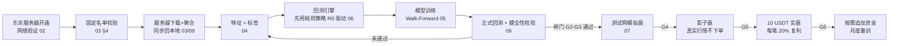

# 币安山寨币超短线做多量化工具 —— 设计书总览

> 版本：v2.1（2026-10-28） 状态：评审中
> 本文件是整套设计书的入口。实现方（人或 AI Agent）请按“阅读顺序”通读全部文档后再动手，任何与本文冲突的口头要求以最新版文档为准。

## 1. 一句话描述

基于**币安**的公开历史数据与 USDⓈ-M 永续合约 API，在使用者确认的**固定币种名单**（13 个训练币 + 3 个留出币，另有名单外盲测币）上，用最近 **24 个月**数据训练一个“跨币种通用”的分钟级突破识别模型，只做多、5x 逐仓；出场采用**保本 + ATR 追踪止损 + 无进展离场**的弹性策略，最长持仓 120 分钟（可调）。先经过严格的 Walk-Forward 回测和多道闸门，通过后依次进入测试网、影子盘、10 USDT 小资金实盘。

**网络原则：使用者在中国大陆、不依赖 VPN。** 所有访问币安的流量（历史数据下载、行情、下单）都只发生在**阿里云日本（东京）服务器**上；本地 Windows 只通过 SSH 与服务器交互、用 RTX 3060 12 GB 训练。看板部署在服务器上，手机/电脑用 HTTPS 访问；通知直接推到**个人微信**（WxPusher），企业微信群机器人作备份。

## 2. 端到端流程

闸门（Gate）定义见 [08-开发计划与验收.md](./08-开发计划与验收.md)。任何一道闸门不通过都不允许进入下一阶段，这是本项目最重要的规则。各阶段通过文件契约解耦，可以一个阶段一个阶段实现、单独交付（08 §6）。

## 3. 文档清单与阅读顺序

| 序号 | 文档                                           | 内容                                                                           | 主要读者   |
| :--- | :--------------------------------------------- | :----------------------------------------------------------------------------- | :--------- |
| 00   | design.md（本文）                              | 总览、索引、关键决策速查、评审意见处理、开源参照、变更记录                     | 所有人     |
| 01   | [01-需求与范围.md](./01-需求与范围.md)         | 背景、目标、非目标、已确认决策、术语、合规与风险                               | 所有人     |
| 02   | [02-系统架构与部署.md](./02-系统架构与部署.md) | 模块划分、目录结构、技术栈、**大陆网络下的部署与同步方案**、手机访问、配置规范 | 开发/运维  |
| 03   | [03-数据与选币.md](./03-数据与选币.md)         | 历史数据下载、存储、数据质量、固定名单与校验、盲测币、24 个月时间切分          | 开发       |
| 04   | [04-特征与标签.md](./04-特征与标签.md)         | 特征全集与公式、防未来函数规则、归一化、预过滤、三重障碍标签                   | 开发/研究  |
| 05   | [05-模型与训练.md](./05-模型与训练.md)         | 模型选型、网络结构、训练流程（含 RTX 3060 建议）、校准、阈值、导出与版本       | 开发/研究  |
| 06   | [06-回测引擎.md](./06-回测引擎.md)             | 成交假设、**出场策略**、成本、仓位、指标、健全性检验、**回测真实性审查清单**   | 开发/研究  |
| 07   | [07-实盘与风控.md](./07-实盘与风控.md)         | 启动流程、下单与改单、风控 R1~R14、对账、运行中调节、微信通知、安全            | 开发/运维  |
| 08   | [08-开发计划与验收.md](./08-开发计划与验收.md) | 阶段 P0~P8、闸门 G1~G6、阶段解耦契约、测试要求、给 Agent 的工作指令            | 开发/Agent |
| 09   | [09-币安数据与API.md](./09-币安数据与API.md)   | 用到的全部币安数据与接口、API Key、签名、限频、费率核对、冒烟测试              | 开发       |
| 10   | [10-可视化看板.md](./10-可视化看板.md)         | 网页看板：页面、手机访问、控制操作、安全、性能                                 | 开发       |
| —    | [../.claude/AGENTS.md](../.claude/AGENTS.md)   | 通用工程规范：代码、注释、文档同步、量化红线、Git、完成报告                    | 开发/Agent |
| —    | [reports/TEMPLATE.md](./reports/TEMPLATE.md)   | 每次任务结束的中文完成报告模板                                                 | 开发/Agent |

## 4. 关键决策速查

| 项目         | 决策                                                                                                                             | 详见             |
| :----------- | :------------------------------------------------------------------------------------------------------------------------------- | :--------------- |
| 数据与交易所 | 全部基于币安：历史数据 data.binance.vision，实时与交易用 USDⓈ-M 合约 API                                                         | 09               |
| 交易市场     | **仅 USDⓈ-M 永续合约**（不再保留现货模式）、单向持仓、逐仓、**5x**、只做多，使用者的币安 API Key 下单                            | 01 §5            |
| 网络         | 本地（中国大陆 IP）不直连币安；一切币安流量在东京服务器上发生；本地 ↔ 服务器只用 SSH（含 git、rsync）                            | 02 §5            |
| 本金与仓位   | 初始 **10 USDT**；每笔保证金 = **当前权益 × 20%**（复利，最多 3 仓）；运行中可在看板 / 命令行调节                                | 06 §5、07 §7.1.1 |
| 止损         | 初始止损随 ATR 自适应，价格的 0.5%~1.5%                                                                                          | 04 §7.1          |
| 出场 / 止盈  | 默认 `trail`：浮盈 ≥ 1R 后止损移到保本，≥ 1.5R 后按 ATR 追踪；20 分钟无进展离场；4R 封顶止盈；`fixed`（2R 止盈）保留作对照       | 06 §3.3          |
| 持仓时间     | 不卡死 30 分钟：标签窗口 `H_label` ∈ {30, 60}（默认 60），出场最长持仓 `H_max` ∈ {60, 120, 240}（默认 120），均在调参期选定      | 04 §7、06 §3.3   |
| 手续费       | **VIP0**，不用 BNB 抵扣；启动时读取账户实际费率核对                                                                              | 06 §4.1、09 §4   |
| 通知         | **个人微信**（WxPusher，主：开平仓、告警、日报）；企业微信群机器人（备份：告警双发、心跳）；飞书可选                             | 07 §8            |
| 可视化       | Streamlit 看板部署在东京服务器，Caddy 提供 HTTPS + 登录认证，**手机浏览器可访问**；Streamlit 本身仍只监听 127.0.0.1              | 10、02 §5.6      |
| 币种         | **固定名单**：13 训练 + 3 留出（使用者推荐 + 设计方补充），由 `select_coins.py --validate` 做可交易性校验；另抽 5 个盲测币       | 03 §4            |
| 数据窗口     | 最近 **24 个完整自然月** + 30 天预热                                                                                             | 03 §6            |
| 验证         | 调参期（M1~M12）与 5 折扩展窗口 Walk-Forward（测试 M13~M22）分离；Purge/Embargo；M23~M24 封存；留出币 + 名单外盲测币             | 03 §6、05 §6     |
| 决策频率     | 每根 1 分钟 K 线收盘后决策一次                                                                                                   | 04 §1            |
| 主模型       | PyTorch 因果 TCN + 注意力池化，5 种子集成                                                                                        | 05 §3、§6.2      |
| 对照模型     | 规则策略 R0（无模型）、LightGBM M0、LSTM M2；主模型必须稳定优于 R0 与 M0                                                         | 05 §2            |
| 回测真实性   | 入场价按 1 秒延迟后的真实逐笔价；入场 K 线只用入场后的逐笔高低点；追踪止损只用已收盘 K 线；逐笔重放、事件驱动对拍、盲测必做      | 06 §3、§7、§9    |
| 实盘部署     | **阿里云 日本（东京）地域**（ECS 或轻量应用服务器），固定公网 IP，交易程序、看板、数据下载都运行在该服务器上；域名建议同账号购买 | 02 §5            |
| 单一实现     | 特征、仓位、出场策略、交易规则取整在回测与实盘中共用同一份代码                                                                   | 02 §3            |

## 5. 对原始草案的主要修订（v1.x 时期，保留）

1. 不使用代理方案：交易程序直接运行在东京服务器上（v2.0 进一步把数据下载也放到服务器，见 02 §5）。
2. 币种从 3~5 个扩为 15 个以上，避免模型学到个别币的“性格”。
3. 新增“留出币”和“封存月”，避免训练数据与回测数据重叠导致结果虚高。
4. 回测不追求“纯向量化”：持仓模拟有路径依赖，用 numba 顺序循环。
5. 入场价不用信号 K 线收盘价（未来函数）。v2.0 进一步改为“下一根开盘后 1 秒的真实逐笔价”。
6. 大单阈值改为每币动态分位数。
7. 主模型由 3 层 LSTM 改为 TCN，LSTM 作消融，新增 LightGBM 基线。
8. 补齐实盘、风控、对账、上线分级、看板、通知。

## 6. 参考依据与可借鉴的开源项目

### 6.1 方法论

- Marcos López de Prado《Advances in Financial Machine Learning》：三重障碍标签、Purged K-Fold 与 Embargo、样本独特性权重、Meta-Labeling。
- Bailey & López de Prado《The Deflated Sharpe Ratio》：多次试验后对夏普的折扣（06 §7 S11）。
- Bai et al. 2018：TCN 结构。Zhang et al. 2019《DeepLOB》：订单流特征组织思路。
- 社区普遍结论：币安撮合部署于 AWS 东京区域（ap-northeast-1）。

### 6.2 GitHub 开源项目（借鉴点与使用方式）

先说明一个事实：**GitHub 上没有被公开验证“持续盈利”的同类策略项目**，能借鉴的是工程成熟度（交易所对接、回测-实盘一致性、风控边界情况），而不是收益。下表按阶段列出借鉴方式。

| 项目                                                                                                       | 借鉴点                                                                                                                          | 本项目的使用方式                                                                                                    | 对应阶段 |
| :--------------------------------------------------------------------------------------------------------- | :------------------------------------------------------------------------------------------------------------------------------ | :------------------------------------------------------------------------------------------------------------------ | :------- |
| `binance/binance-public-data`                                                                              | data.binance.vision 的目录结构、下载脚本、CHECKSUM 校验                                                                         | 参照其路径规则实现下载器                                                                                            | P1       |
| `binance/binance-connector-python`（模块化 SDK，USDⓈ-M 包 `binance-sdk-derivatives-trading-usds-futures`） | 官方维护，跟进接口变更（如 2025-12 条件单迁移到 Algo 接口）、签名实现                                                           | 签名 REST（账户、下单、算法条件单）**直接使用官方 SDK**，锁定版本，封装在 `ExchangeClient` 后面；WebSocket 行情自研 | P5       |
| `freqtrade/freqtrade`（含 FreqAI）                                                                         | 训练-回测-实盘同一套特征代码、滚动重训、交易所侧止损（stoploss on exchange）、币安合约各类错误码处理经验（其 issue 区很有价值） | 不作为运行框架（不支持本项目所需的逐笔原子量与成交模拟细节），只参照设计与边界情况                                  | P3、P5   |
| `nautechsystems/nautilus_trader`                                                                           | 事件驱动回测与实盘同一套代码、订单状态机、币安合约适配器                                                                        | 参照其订单状态机和事件驱动回测思路实现 06 §7 S9 的参考模拟器                                                        | P3、P5   |
| `hummingbot/hummingbot`                                                                                    | 交易所连接器的重连、限频、订单跟踪                                                                                              | 参照 WebSocket 重连与订单跟踪实现                                                                                   | P5       |
| `jesse-ai/jesse`                                                                                           | K 线内价格路径的保守处理、简洁的策略接口                                                                                        | 参照其 K 线级成交假设做对照                                                                                         | P3       |
| `microsoft/qlib`                                                                                           | 量化 ML 流水线、滚动重训、TCN/ALSTM 等基线实现                                                                                  | 参照其滚动训练与模型对比流程                                                                                        | P4       |
| `locuslab/TCN`                                                                                             | TCN 参考实现                                                                                                                    | 对照实现 M1 的因果卷积块                                                                                            | P4       |
| `polakowo/vectorbt`                                                                                        | 向量化参数扫描                                                                                                                  | 只借鉴参数扫描的组织方式；有路径依赖的成交模拟不用它                                                                | P3       |
| `optuna/optuna`                                                                                            | 超参搜索与剪枝                                                                                                                  | 在调参期内做 ≤ 30 组搜索（05 §6.1）                                                                                 | P4       |

为什么不直接基于 Freqtrade / Nautilus 实现：本项目的核心是“分钟内逐笔原子量 + 1 秒延迟入场 + 追踪止损的保守 K 线模拟”，这些在现成框架里都要深度改造，改造成本与自研相当，且框架升级会带来额外维护负担。实盘下单这类“写错会亏钱”的部分则反过来，优先用官方 SDK。

## 7. v2.0 评审意见处理表

| #   | 使用者意见                  | 处理结论                                                                                                                                                                                                                                      | 采纳程度           | 详见             |
| :-- | :-------------------------- | :-------------------------------------------------------------------------------------------------------------------------------------------------------------------------------------------------------------------------------------------- | :----------------- | :--------------- |
| 1   | VPN 不稳定，方案侧重大陆 IP | 本地完全不需要访问币安/GitHub/海外站点：数据下载、行情、交易全部在东京服务器；本地 ↔ 服务器只用 SSH（git over SSH、rsync）；本地依赖走国内镜像；通知用企业微信（国内服务）                                                                    | 采纳               | 02 §5            |
| 2   | 用 API Key 交易 U 本位永续  | 确认，删除现货模式，降低复杂度                                                                                                                                                                                                                | 采纳               | 01 §5、09        |
| 3   | 参照 GitHub 成功项目        | 列出借鉴清单；下单改用官方 SDK；说明“没有公开验证盈利的同类项目”，借鉴的是工程而不是收益                                                                                                                                                      | 采纳（附说明）     | 本文 §6.2        |
| 4   | 更弹性的止盈                | 新增出场策略模块：保本 + ATR 追踪 + 无进展离场 + 封顶止盈；追踪只在 K 线收盘时更新，保证回测可如实复现；分批止盈在本金 ≥ 最小下单额 4 倍后再开启                                                                                              | 采纳               | 06 §3.3、07 §5.2 |
| 5   | 通知用微信                  | 飞书消息推不到微信，企业微信群机器人消息也不会转到个人微信。v2.1 按使用者要求：**个人微信（WxPusher）为主通道**，企业微信群机器人作备份（告警双发、心跳）。个人微信机器人（hook/网页协议）有封号风险，腾讯官方 ClawBot 不能主动推送，均不采用 | 采纳（方案调整）   | 07 §8            |
| 6   | 手机访问网页                | 看板部署在服务器，Caddy 反向代理提供 HTTPS + 登录认证，手机浏览器访问；控制操作仍需 PIN；备用通道为手机 SSH App 执行 `kill_switch.py`                                                                                                         | 采纳               | 10 §5、02 §5.6   |
| 7   | 流程解耦、分阶段实现        | 各阶段以文件为契约；回测引擎先用规则策略 R0 驱动，与模型解耦；实盘引擎可用 R0 或假模型联调                                                                                                                                                    | 采纳               | 08 §6            |
| 8   | 训练币种                    | 采用固定名单。CL（原油）、SNDK（闪迪股票）是 TradFi 合约，行情驱动与交易时段不同，**不纳入**；牛来上线时间太短，**暂不纳入**；龙虾作留出币；补充 DOGE、LINK、ENA、TAO、ARB、AVAX 覆盖更多板块；另设名单外盲测币检验“事后挑币”偏差             | 部分采纳（附理由） | 03 §4            |
| 9   | 数据窗口 24 个月            | 采纳；同时引入调参期与 5 折 Walk-Forward，并提示 24 个月跨越不同行情阶段，加入时间衰减权重作为可选超参                                                                                                                                        | 采纳               | 03 §6、05 §6     |
| 10  | 持仓时间不卡死 30 分钟      | 标签窗口与出场最长持仓分开配置，配合追踪止损与无进展离场；默认 60 / 120 分钟，在调参期从候选值中选定。不建议无上限持仓（分钟级信号的有效期有限，持仓越长越暴露于大盘与资金费）                                                                | 采纳（附建议）     | 04 §7、06 §3.3   |
| 11  | 3060 训练建议               | 数据整体放 GPU（fp16 约 1.5 GB），不用 DataLoader；bf16 混合精度；5 种子集成；先跑 LightGBM 与 R0；可选 WSL2 与服务器环境一致                                                                                                                 | 采纳               | 05 §6.2          |
| 12  | 留出币是什么                | 完全不参与训练、只在测试段与封存集上评估的币，用来检验模型是否真的“跨币种通用”                                                                                                                                                                | 解释               | 01 §6、03 §4.3   |
| 13  | 大陆不开 VPN 用东京服务器   | 可以：交易程序在服务器上直连币安，与本地网络无关。v2.1 起改用**阿里云日本（东京）地域**（支付宝付款、中文控制台、对大陆线路通常更稳），与币安所在的 AWS 东京同城，延迟影响可忽略；附云厂商停机风险与应对                                      | 采纳（附风险说明） | 02 §5.1、01 §7   |
| 14  | 回测真实性审查              | 审查后修正 6 处偏乐观的假设（入场延迟、入场 K 线止盈、EWM 预热不一致、调参泄露测试月、事后选币、追踪止损 K 线内路径），新增 S8 逐笔重放（改为必做）、S9 事件驱动对拍、S10 盲测、S11 试验次数登记                                              | 采纳               | 06 §9            |

## 8. 文档变更记录

实质性修改（影响行为、阈值、接口、闸门）在此追加一行，规则见 AGENTS.md §5.2。

| 日期       | 版本 | 修改文档                                                      | 内容                                                                                                                                                                                                                                                                                                                              | 理由                                 |
| :--------- | :--- | :------------------------------------------------------------ | :-------------------------------------------------------------------------------------------------------------------------------------------------------------------------------------------------------------------------------------------------------------------------------------------------------------------------------- | :----------------------------------- |
| 2026-10-27 | v1.0 | 全部                                                          | 由单文件草案扩充为 01~08 + AGENTS.md                                                                                                                                                                                                                                                                                              | 初版                                 |
| 2026-10-27 | v1.1 | 01、02、06 §5、07 §7.1.1、08 §3                               | 仓位改为使用者手动设置每笔占本金比例，新增单笔亏损硬上限、启动校验、运行中调节、比例敏感性扫描；闸门改用固定参考仓位判定                                                                                                                                                                                                          | 本金小，固定 0.5% 风险算出的仓位过小 |
| 2026-10-27 | v1.2 | 01、02、03 §4、06、07、08、新增 09、10                        | 确认 5x、10 USDT、VIP0、飞书；新增币安数据与 API 说明、localhost 看板；风控新增 R14 权益下限；阶段编号调整为 P0~P8                                                                                                                                                                                                                | 使用者确认参数与新需求               |
| 2026-10-27 | v1.3 | 01、02、03、04 §7.1、05 §6.1、06 §5、07 §7、08、10、AGENTS.md | 固定每笔 20%（按当前权益复利）；止损 ATR 自适应 0.5%~1.5%、止盈 = 2 倍止损；风控阈值 5% / 8% / 20%；`sizing.yaml`                                                                                                                                                                                                                 | 使用者确认                           |
| 2026-10-28 | v2.0 | 全部 + AGENTS.md                                              | 大陆网络优先部署（服务器下载数据、SSH 同步、国内镜像）；仅 USDⓈ-M；固定币种名单 + 盲测币；数据窗口 24 个月与新时间切分；出场策略模块（保本/追踪/无进展/封顶）；持仓上限可调；入场延迟与入场后逐笔高低点；预热 30 天；企业微信通知；看板服务器部署 + HTTPS 手机访问；规则策略 R0；阶段 P3/P4 对调；健全性检验 S8 必做、新增 S9~S11 | 使用者第一轮评审意见（本文 §7）      |
| 2026-10-28 | v2.1 | design、01、02、03 §4、05 §6.2、07 §8、08、10                 | 服务器由 AWS 东京改为阿里云日本（东京）地域；通知改为个人微信（WxPusher）主 + 企业微信备份；AKE 确认保留，名单校验分“阻断/警告”两级；显卡确认 12 GB；域名建议在阿里云购买                                                                                                                                                         | 使用者第二轮确认                     |
